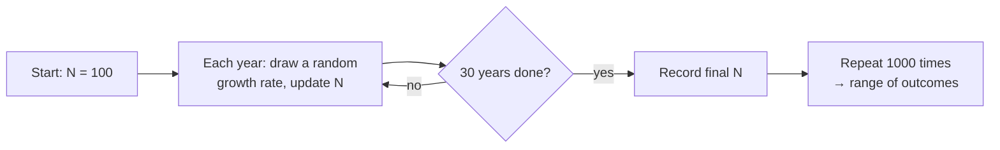

# Simulation Model

Nobody can work out with algebra who will win a board game with dice, even though the rules are simple: roll, move, follow the square's instruction. So you just play it, and if you play it a thousand times you learn which strategies tend to win and how often. A **simulation model** treats nature the same way: it runs a set of rules forward on a computer, one *time step* (such as one year) at a time, keeping track of *state variables* such as population size N, and it is used when a system has too many interacting parts to work out with pen and paper. Hobbs and Hooten note that nonlinear systems with many state variables are usually "mathematically intractable", too complicated to solve with algebra; each single step, though, is easy arithmetic, so the computer can take the journey one step at a time ([[Hobbs and Hooten 2015 Ch2]], [[For Loop|For Loops]]).

A tiny stochastic simulation, one that includes chance. Start with 100 animals, and each year flip a coin: heads is a good year (multiply by 1.15), tails a bad year (multiply by 0.9). One *run*, a complete play-through, goes good, bad, good: 100 → 115 → 103.5 → about 119. Another goes bad, bad, good: 100 → 90 → 81 → about 93. Same rules, different luck, different futures. Run 30 years a thousand times and count how many runs end below 50 animals; that fraction estimates how risky the population's situation is. One run is one possible future; the useful answer is the spread over many runs.

Simulation handles what pen and paper cannot: many interactions across space, time and individuals, plus chance. It is also a way to check statistics: simulate data from a model with known parameters, fit the model, and see whether you get the parameters back, because a method that cannot recover the truth from fake data will not be trustworthy on real data; Hobbs and Hooten use this to check MCMC code ([[Hobbs and Hooten 2015 Ch7]]). Powell and Gale add that simulating can be cheaper than running an experiment ([[Powell and Gale 2015 Ch1]]). The weaknesses, per Hobbs and Hooten, are that parameter values are usually picked rather than estimated, so uncertainty has no coherent statistical treatment, and a pull toward "unbridled complexity", since adding one more rule always seems cheap while each rule is another assumption. Simulation results are not data: they show what *would* happen *if* the rules were right. Compare an [[Analytical Model]], whose equations can be solved directly.


*What to look at:* the loop. A simulation is a loop that applies the model's rules over and over.

```r
set.seed(2)
simulate_pop <- function(N0 = 100, years = 30) {
  N <- N0
  for (t in 1:years) {
    lambda <- sample(c(0.9, 1.15), 1)   # random good or bad year
    N <- N * lambda
  }
  N
}
finals <- replicate(1000, simulate_pop())  # 1000 possible futures
mean(finals < 50)                          # proportion of runs that crashed below 50
hist(finals, main = "Population after 30 years (simulated)")
```

## Connections
- **Builds on:** [[Analytical Model]], [[For Loop|For Loops]]
- **Leads to:** [[Sensitivity Analysis]], [[Theoretical vs Empirical Modeling]], [[MCMC]]
- **Part of:** [[MOC 02 - Modeling Foundations|MOC - Modeling Foundations]]
- **Go deeper:** [[Hobbs and Hooten 2015 Ch2]] (§2.1.3)

## Flashcards

When do you need a simulation model instead of solving equations?
??
When many interacting variables make the equations impossible to solve analytically, so you step them forward on a computer.
++++

Why simulate fake data from a model with known parameters?
??
To check that your fitting method recovers the truth; if it can't on fake data, it can't be trusted on real data.
++++

What are the main weaknesses of the simulation style (Hobbs and Hooten)?
??
No statistically coherent treatment of uncertainty, and a tendency to build overly complex models.
++++
