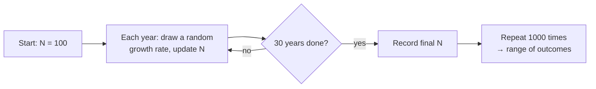

# Simulation Model

**In one line:** a simulation model runs a set of rules forward on a computer, step by step, to see what happens. It's used when a system has too many interacting parts to work out with pen and paper.

> [!info] Before this, it helps to know
> [[Analytical Model]] (equations with given parameters) · [[For Loop|For Loops]] (repeating a step many times)

## The everyday picture
A board game with dice. The rules are simple (roll, move, follow the square's instruction), but nobody can work out with algebra who'll win. So you just **play it** and see. Play it a thousand times and you learn which strategies tend to win and how often.

A simulation model is nature turned into a game with rules and dice. The computer plays year after year, and then plays the whole thing again and again to show the range of things that could happen.

*Where the picture stops working:* a board game's rules are known exactly. A simulation's rules are your guesses about nature, so its results are only as good as those guesses.

## Words you'll need
- **Simulation:** running a model's rules forward one step at a time on a computer.
- **Time step:** one turn of the loop, such as one year.
- **State variable:** a quantity the simulation keeps track of, such as population size N.
- **Stochastic (random):** including chance, like a dice roll for good or bad years.
- **Run (replicate):** one complete play-through of the simulation.
- **Growth multiplier (λ, "lambda"):** the number N is multiplied by each year.
- **Intractable:** too complicated to solve with algebra.

## A tiny example
Start with 100 animals. Each year, flip a coin: heads is a good year (multiply by 1.15), tails a bad year (multiply by 0.9).
- One run: good, bad, good → 100 × 1.15 = 115 → 115 × 0.9 = 103.5 → 103.5 × 1.15 ≈ **119**.
- Another run: bad, bad, good → 100 × 0.9 = 90 → 81 → 81 × 1.15 ≈ **93**.

Same rules, different luck, different futures. Run 30 years, 1,000 times, and count how many runs end below 50 animals. That fraction is an estimate of how risky the population's situation is.

## Start from zero
1. **Simple equations can be solved by hand.** N after 10 years at 4% growth is N₀ × 1.04¹⁰.
2. **Real systems have many parts that affect each other.** Grass depends on rain and grazing; grazers depend on grass and predators; predators depend on grazers.
3. **With many interacting parts, the maths usually can't be solved directly.** Hobbs and Hooten note that nonlinear systems with many state variables are "mathematically intractable" ([[Hobbs and Hooten 2015 Ch2]], p. 18).
4. **So pick parameter values and let the computer step through time:** year 1, then year 2, and so on. *Why it works:* each single step is easy arithmetic, even when the whole journey is impossible to solve in one go.
5. **Add randomness at each step and run it many times.** *Why:* nature has good and bad years. Many runs show how likely different futures are, not just one projection.
6. **Simulation is also a way to check statistics.** Simulate data from a model with known parameters, fit the model, and see whether you get the parameters back. *Why:* if a method can't recover the truth from fake data where you *know* the truth, don't trust it on real data. Hobbs and Hooten use this to check MCMC code ([[Hobbs and Hooten 2015 Ch7]], §7.3.5).

## See it

*What to look at:* the loop. A simulation is a loop that applies the model's rules over and over.

## Why it is this way
Simulation handles what pen and paper can't: many interactions across space, time and individuals, plus chance. You give up a neat formula for the answer and get a pile of possible outcomes instead. Its weaknesses, per Hobbs and Hooten, are the lack of a statistically coherent treatment of uncertainty (the parameter values are usually picked, not estimated from data) and a tendency toward "unbridled complexity", because adding one more rule always seems cheap ([[Hobbs and Hooten 2015 Ch2]], pp. 20 to 21).

## In R
```r
set.seed(2)
simulate_pop <- function(N0 = 100, years = 30) {
  N <- N0
  for (t in 1:years) {
    lambda <- sample(c(0.9, 1.15), 1)   # random good or bad year
    N <- N * lambda
  }
  N
}
finals <- replicate(1000, simulate_pop())  # 1000 possible futures
mean(finals < 50)                          # proportion of runs that crashed below 50
hist(finals, main = "Population after 30 years (simulated)")
```

## In the course
Powell and Gale list simulation as a reason to model when resources are scarce: it can be cheaper to simulate a population than to run an experiment ([[Powell and Gale 2015 Ch1]], p. 6). Simulating fake data to understand a model is a habit used throughout the labs.

## Common confusions
- **"Simulation results are data."** They are consequences of your assumptions. They show what *would* happen *if* the rules were right.
- **"More detail means more realism."** Each extra rule needs its own parameter values, and each one is another assumption.
- **"One run is the prediction."** One run is one possible future. The useful answer is the spread over many runs.

## Explain it back
- Use a dice board game to explain what a simulation is.
- Why run a simulation 1,000 times instead of once?
- Why would you simulate fake data before analysing real data?

*Pass test:* you can describe, in plain steps, the loop inside a population simulation.

## Connections
- **Builds on:** [[Analytical Model]], [[For Loop|For Loops]]
- **Leads to:** [[Sensitivity Analysis]], [[Theoretical vs Empirical Modeling]], [[MCMC]]
- **Part of:** [[MOC 02 - Modeling Foundations|MOC - Modeling Foundations]]
- **Go deeper:** [[Hobbs and Hooten 2015 Ch2]] (§2.1.3)

## Flashcards

When do you need a simulation model instead of solving equations?
??
When many interacting variables make the equations impossible to solve analytically, so you step them forward on a computer.
++++

Why simulate fake data from a model with known parameters?
??
To check that your fitting method recovers the truth; if it can't on fake data, it can't be trusted on real data.
++++

What are the main weaknesses of the simulation style (Hobbs and Hooten)?
??
No statistically coherent treatment of uncertainty, and a tendency to build overly complex models.
++++
