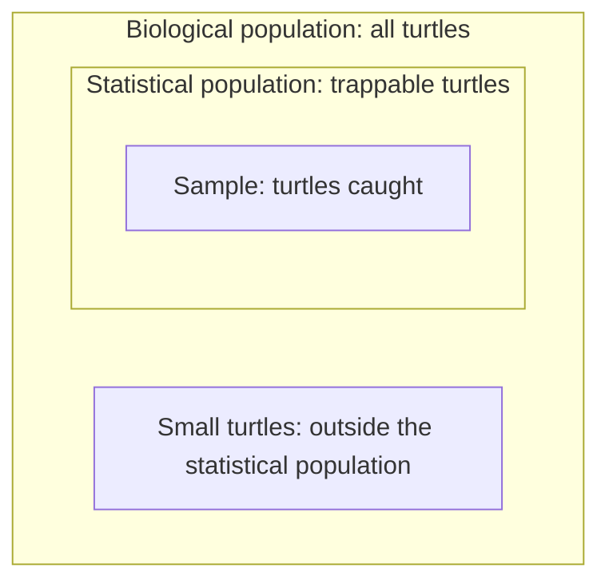

# Statistical Population

Fish a lake with a net whose holes are 5 cm wide. The lake holds fish of every size, but anything smaller slips through, so however many times you cast, you only ever sample fish too big for the holes. That catchable group is the **statistical population**: all the units that could have ended up in your sample, given your method ([[Powell and Gale 2015 Ch2]]). The units are pieces of time and space you could sample, such as plots, trap-nights or survey visits ([[Sampling Unit]]). Seen from the results side, the same set is your *[[Line of Inference|scope of inference]]*, the set your conclusions actually cover.

Powell and Gale's turtle example. A pond holds 8 turtles with shells of 4, 5, 6, 12, 14, 15, 18 and 20 cm, so the [[Biological Population]] has a mean of 11.75 cm. Floating traps catch only turtles of 10 cm or more, so the statistical population is the 5 trappable turtles, with a mean of 79 / 5 = 15.8 cm. Trap a thousand times and the estimate settles near 15.8, not 11.75. More effort cannot fix it, because the small turtles were never in the running; more of the same traps just estimates the same statistical population more precisely.

The maths behind any estimate assumes each unit had a chance of selection, and it is silent about units that had none. That makes the statistical population the true reach of every conclusion, and the gap between it and the biological population a common, invisible source of [[Bias]]. A net's holes are visible, but a survey's "holes" (time of day, distance from roads, animals that avoid traps) often are not, which is why you should state the statistical population in your methods, and why the [[Final Project]] asks exactly how data were collected. It is not the same as the sample, which is a subset of it ([[Population]]).


*What to look at:* the estimate speaks only for the middle box.

```r
turtles   <- c(4, 5, 6, 12, 14, 15, 18, 20)
trappable <- turtles[turtles >= 10]   # what floating traps can catch
length(trappable); mean(trappable)    # 5 turtles, 15.8 cm: the estimate's real target
```

## Connections
- **Builds on:** [[Population]], [[Biological Population]], [[Sampling Unit]], [[Line of Inference]]
- **Leads to:** [[Representative Sample]], [[Bias]], [[Observation Error]]
- **Part of:** [[MOC 02 - Modeling Foundations|MOC - Modeling Foundations]], molecular note [[Biological vs Statistical Population]]
- **Go deeper:** [[Powell and Gale 2015 Ch2]]

## Flashcards

What is the statistical population?
??
The set of units your sampling method could actually have measured; your conclusions apply only to it.
++++

In Powell and Gale's turtle example, what does the mark-recapture estimate describe and why?
??
Only large turtles, because floating traps do not catch small turtles, so small turtles are outside the statistical population.
++++
