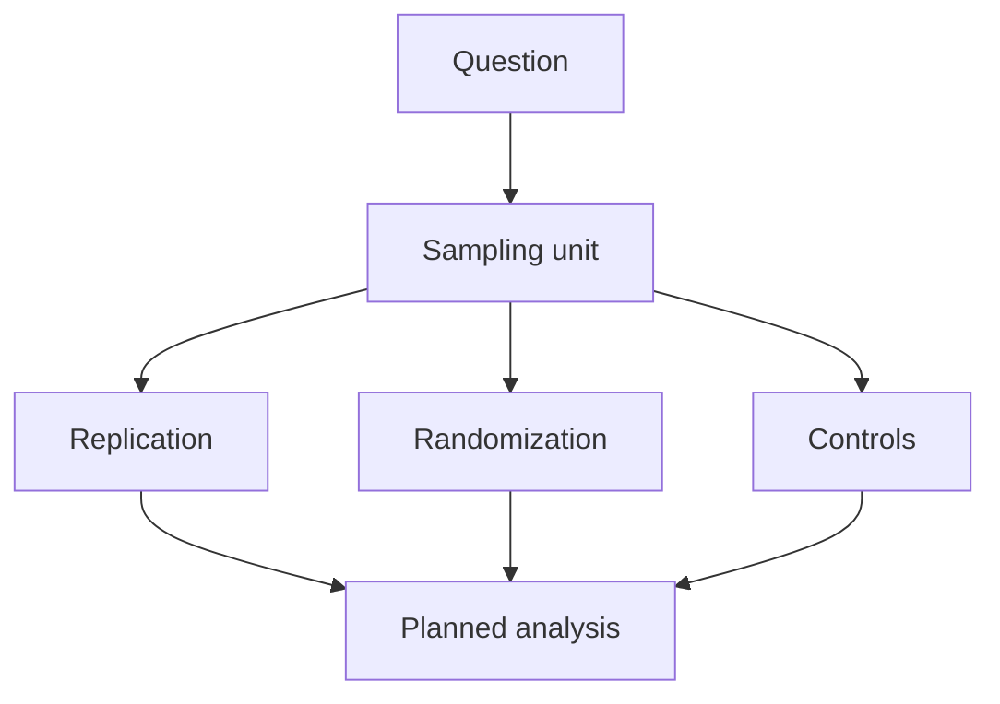

# Study Design

Packing for a mountain trip is a set of decisions you cannot undo once you are on the mountain: no amount of cleverness up there brings the tent you left at home. **Study design** is the packing: the plan, made before collecting any data, for what to measure, where, when and how often, so that the data can answer your question. After the field season, no analysis can supply what was not collected. A packing list can be copied from others, but a design must be built around your own question, and it is needed just as much for observational surveys as for experiments.

Compare two designs for the question "does burning raise bird [[Species Richness|richness]]?". A weak design surveys 10 burned plots in one valley and 10 unburned plots in another; burning and valley are then tangled together and can never be told apart. A stronger design uses 10 pairs of neighbouring plots spread across the region, with one plot in each pair chosen by coin flip to burn, and surveys all of them before and after. Same effort, very different evidence. The steps are: write the question and the comparison it needs; choose the [[Sampling Unit]]; decide how units are chosen ([[Random Sampling]]) and how treatments are assigned ([[Randomization]]); plan [[Replication]], because without several independent units per condition you cannot separate an effect from natural differences; anticipate nuisance variables and balance or measure them; include a [[Control Group]]; and write down the analysis before the data exist. If you cannot say how you will analyse the data, the design is not finished.

Statistics can describe uncertainty, but it cannot rescue a comparison that is [[Confounding|confounded]] or unreplicated. Fisher's old remark still holds: consulting a statistician after the experiment is asking for a post-mortem. A clever model only adjusts and assumes; it cannot create missing information. Most of the problems the course's models fix, such as [[Independence of Observations|non-independence]] and [[Balanced Data|unbalanced data]], are design problems first, which is why the course asks you to critique the nested thistle experiment in Homework 4 ([[Nested Experimental Design]]) and requires a final project whose design matches its analysis ([[Final Project]]). Design also sets what the data can speak for ([[Line of Inference]]) and which [[Hypothesis]] they can test.

*What to look at:* replication, randomization and controls are the three supports under any analysis.

## Connections
- **Builds on:** [[Hypothesis]], [[Random Sampling]]
- **Leads to:** [[Replication]], [[Randomization]], [[Control Group]], [[Nested Experimental Design]], [[Species Richness]], [[Confounding]], [[Independence of Observations]], [[Balanced Data]]
- **Part of:** [[MOC 02 - Modeling Foundations|MOC - Modeling Foundations]]

## Flashcards

What is study design?
??
The advance plan for what, where, when and how to measure so the data can answer the question.
++++

What are the three supports of a sound comparison?
??
Replication, randomization and controls.
++++

Can analysis fix a confounded design?
??
No. Statistics can't supply information the design failed to collect.
++++
