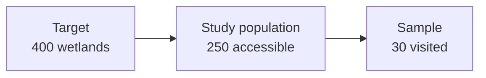

# Study Population

Imagine a phone survey meant to describe all adults in a city. You can only reach people with a listed number who pick up, so the people who could possibly have ended up in your survey are a smaller and different group than the city. In ecology, the **study population** (also called the sampled population or *sampling frame*) is that reachable set: the units your sampling method could actually have selected. It sits between the *target population*, what you want to learn about ([[Biological Population]]), and the sample, the units you actually measured ([[Sample]]). A phone list is written down, but in ecology the reachable set is often fuzzy, such as "wherever a truck can get to".

An example. You want to learn about all 400 wetlands in a county, but only 250 are on public land with access, and you sample 30 of those at random. The study population is the 250 accessible wetlands; the other 150 had zero chance of selection, so the data say nothing direct about them. Suppose private wetlands happen to hold more frogs (14 on average) than accessible ones (8). The county-wide average is then about 10.3, but your random sample of accessible wetlands reports about 8: an accurate description of the accessible wetlands and a poor one of the county. A random sample makes results apply to the population it was drawn from, which is the study population, not everything you hoped to cover ([[Random Sampling]], [[Representative Sample]]).

Naming the study population forces the awkward question: who had no chance of being in my data? Roadside surveys, daylight surveys and fair-weather surveys all quietly redefine the population, and units with no chance of selection contribute no information. Any step from the study population to the wider target needs outside argument, not more statistics; this is the second link in the [[Line of Inference]]. Powell and Gale separate target, sampled and statistical populations to make exactly this point ([[Powell and Gale 2015 Ch2]], [[Statistical Population]]). How units are chosen from the frame is the subject of [[Survey Sampling Designs]].


*What to look at:* each box is a subset of the one before it.

```r
set.seed(1)
wet <- data.frame(access = rep(c(TRUE, FALSE), c(250, 150)))
wet$frogs <- rpois(400, ifelse(wet$access, 8, 14))     # private wetlands are richer
mean(wet$frogs)                                        # target truth: about 10.3
mean(sample(wet$frogs[wet$access], 30))                # what the study can see: about 8
```
The sample describes accessible wetlands well and the county poorly.

## Connections
- **Builds on:** [[Statistical Population]], [[Line of Inference]]
- **Leads to:** [[Random Sampling]], [[Representative Sample]], [[Survey Sampling Designs]]
- **Part of:** [[MOC 02 - Modeling Foundations|MOC - Modeling Foundations]], molecular note [[Biological vs Statistical Population]]

## Flashcards

What is the study population?
??
The set of units that could actually have been selected by the sampling method.
++++

How does it differ from the target population?
??
The target is what you want to learn about. The study population is what you could reach.
++++

To what do results from a random sample apply directly?
??
To the study population the sample was drawn from.
++++
