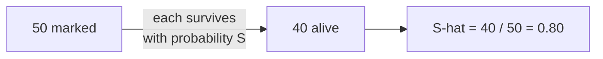

# Survival Rate

**In one line:** a survival rate is the probability that an individual alive at the start of a period is still alive at its end.

> [!info] Before this, it helps to know
> [[Proportion]] (part over whole) · [[Binomial Sampling]] (counting successes in trials) · [[Population Dynamics]] (where deaths fit)

## The everyday picture
A stack of coin flips. Each animal faces a weighted coin each year: heads it lives, tails it dies. The survival rate is the weight of the coin. You can't see the weight, only how the flips came out.

*Where the picture stops working:* coins are identical. Animals have different coins, and the weights shift with age and season.

## A tiny example
50 radio-collared deer in January. 40 alive in December.
- Annual survival Ŝ = 40 / 50 = **0.80**.
- SE = √(0.8 × 0.2 / 50) = **0.057**.
- Monthly survival, if constant: 0.80^(1/12) = **0.9816**.
- Two-year survival: 0.80² = **0.64**.

## Start from zero
1. **Mark a known number of animals.**
2. **Count how many are alive later.**
3. **Divide.** Ŝ = alive / marked.
4. **Always state the period.** *Why:* 0.8 per year and 0.8 per month are wildly different.
5. **Survival multiplies across periods.** Two years is S × S.
6. **This only works if every fate is known.** If some animals just weren't seen, you need models that separate survival from detection ([[Cormack-Jolly-Seber Model]]).

## See it

*What to look at:* survival is a binomial proportion when all fates are known.

## Why it is this way
Survival is usually the vital rate that population growth of long-lived animals is most sensitive to, and the one most affected by management. It is also the textbook case of a binomial parameter, which is why Powell and Gale use it to teach estimation.

## In R
```r
alive <- 40; n <- 50
S <- alive / n; se <- sqrt(S * (1 - S) / n); c(S, se)   # 0.80 0.057
S^(1/12); S^2                                           # monthly 0.9816, two-year 0.64
binom.test(alive, n)$conf.int                           # exact 95% interval
```
The exact interval runs from about 0.66 to 0.90.

## In the course
[[Powell and Gale 2015 Ch2]] and [[Powell and Gale 2015 Ch3]] build likelihood from survival examples.

## Common confusions
- **"Survival rate and mortality rate are unrelated numbers."** Mortality = 1 − survival for the same period.
- **"Not seen means dead."** Only if detection is perfect.

## Explain it back
- Convert an annual survival of 0.5 to a monthly rate.
- When is alive / marked a valid survival estimate?

*Pass test:* you can estimate survival and its standard error from known fates and rescale it to another period.

## Connections
- **Builds on:** [[Proportion]], [[Binomial Sampling]]
- **Leads to:** [[Known-fate Models]], [[Apparent Survival]], [[Maximum Likelihood Estimation]]
- **Part of:** [[MOC 02 - Modeling Foundations|MOC - Modeling Foundations]]

## Flashcards

What is a survival rate?
??
The probability an individual alive at the start of a period is alive at the end.
++++

How do you convert annual survival S to monthly survival?
??
Take the 12th root: S^(1/12).
++++

When does alive / marked estimate survival correctly?
??
When the fate of every marked animal is known.
++++
