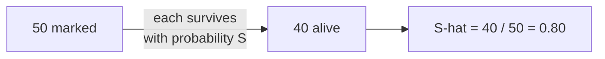

# Survival Rate

Picture each animal flipping a weighted coin each year: heads it lives, tails it dies. The **survival rate** (written S) is the weight of the coin: the probability that an individual alive at the start of a period is still alive at its end. You cannot see the weight, only how the flips came out, so survival must be estimated. Mortality for the same period is simply 1 − S. Real coins are identical, but animals have different coins, and the weights shift with age and season ([[Individual Variation]]).

When the fate of every marked animal is known, survival is a plain [[Proportion]] and a classic [[Binomial Sampling]] problem. Fifty deer are radio-collared in January and 40 are alive in December. The estimate is Ŝ = 40 / 50 = 0.80, with a [[Standard Error|standard error]] of √(0.8 × 0.2 / 50) = 0.057 and an exact 95% interval of about 0.66 to 0.90. Always state the period, because 0.8 per year and 0.8 per month are wildly different. Survival multiplies across periods: two-year survival is 0.80² = 0.64, and if survival is constant through the year, monthly survival is the twelfth root, 0.80^(1/12) = 0.9816.

Survival is usually the vital rate to which the growth of long-lived populations is most sensitive, and the one most affected by management, which is why it is central in [[Population Dynamics]]. It is also the textbook case of a binomial parameter, so Powell and Gale use it to teach likelihood and estimation ([[Powell and Gale 2015 Ch2]], [[Powell and Gale 2015 Ch3]], [[Maximum Likelihood Estimation]]). The big caution is detection. Alive divided by marked is a valid estimate only when every fate is known, as with radio collars ([[Known-fate Models]]). If some animals simply were not seen again, "not seen" does not mean "dead", and you need models that separate survival from detection, such as the [[Cormack-Jolly-Seber Model]], whose estimate is [[Apparent Survival]] because animals that leave look the same as animals that die.


*What to look at:* survival is a binomial proportion when all fates are known.

```r
alive <- 40; n <- 50
S <- alive / n; se <- sqrt(S * (1 - S) / n); c(S, se)   # 0.80 0.057
S^(1/12); S^2                                           # monthly 0.9816, two-year 0.64
binom.test(alive, n)$conf.int                           # exact 95% interval
```
The exact interval runs from about 0.66 to 0.90.

## Connections
- **Builds on:** [[Proportion]], [[Binomial Sampling]], [[Standard Error]]
- **Leads to:** [[Known-fate Models]], [[Apparent Survival]], [[Maximum Likelihood Estimation]]
- **Part of:** [[MOC 02 - Modeling Foundations|MOC - Modeling Foundations]]

## Flashcards

What is a survival rate?
??
The probability an individual alive at the start of a period is alive at the end.
++++

How do you convert annual survival S to monthly survival?
??
Take the 12th root: S^(1/12).
++++

When does alive / marked estimate survival correctly?
??
When the fate of every marked animal is known.
++++
