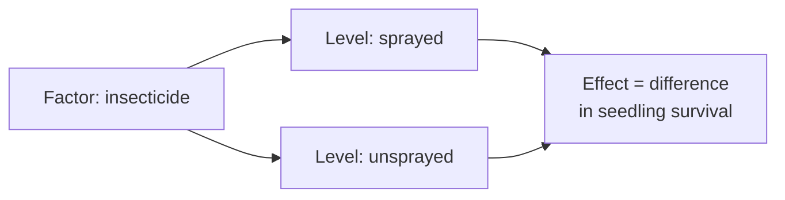

# Treatment

When you try a new cake recipe with less sugar, the change you made is the treatment, and everything else stays as in the usual recipe, so any difference in the cake can be blamed on the sugar. In research, a **treatment** is a condition a researcher deliberately applies to units in order to see its effect, as in an [[Experimental Study]]. The thing being manipulated is a *factor*, and its different versions are its *levels*: present or absent, or several doses. "Treatment" is not a medical word here; fire, grazing, watering and removal are all treatments. In a model, the treatment enters as an [[Explanatory Variable]], usually a categorical one.

The thistle experiment from Homework 4 is a good example. Half the subplots are sprayed with insecticide and half are not, so the factor "insecticide" has two levels, sprayed and unsprayed. A second factor, distance from tall thistle, has five levels (0, 7.5, 15, 30 and 60 m). Together they make 2 × 5 = 10 treatment combinations, which R can list with `expand.grid()` ([[expand.grid()]]). The effect of a treatment is the difference in response between its levels, because that difference is what the manipulation, and nothing else, changed; with two crossed factors the analysis is a [[Two-way ANOVA]], and R codes the levels as 0/1 columns ([[Dummy Coding]]). The experiment tests the [[Enemy Release Hypothesis]].

Two practical points. First, applying a treatment often changes other things too: spraying also wets and disturbs a plot, and in the field you cannot hold everything constant the way you can in a kitchen. That is why controls get a sham treatment such as plain water ([[Control Group]]). Second, a treatment is applied to units, not to every measurement: if a subplot is sprayed once and measured twenty times, the twenty measurements share one application, and the model must be matched to the level at which the treatment was applied. Naming the treatment precisely, including how and to which unit it was applied, fixes what the experiment can say.


*What to look at:* a factor has levels, and the effect is a comparison between them.

```r
design <- expand.grid(spray = c("no", "yes"), distance = c(0, 7.5, 15, 30, 60))
nrow(design); head(design, 4)          # 10 combinations
```
`expand.grid()` lists every combination of factor levels ([[expand.grid()]]).

## Connections
- **Builds on:** [[Experimental Study]]
- **Leads to:** [[Control Group]], [[Two-way ANOVA]], [[Dummy Coding]]
- **See also:** [[Treatment|Treatment and Control]]
- **Part of:** [[MOC 02 - Modeling Foundations|MOC - Modeling Foundations]]

## Flashcards

What is a treatment?
??
A condition deliberately applied to experimental units to measure its effect.
++++

What are levels of a treatment factor?
??
The different versions of the condition, such as sprayed and unsprayed.
++++

How many combinations do a 2-level and a 5-level factor give?
??
10.
++++
