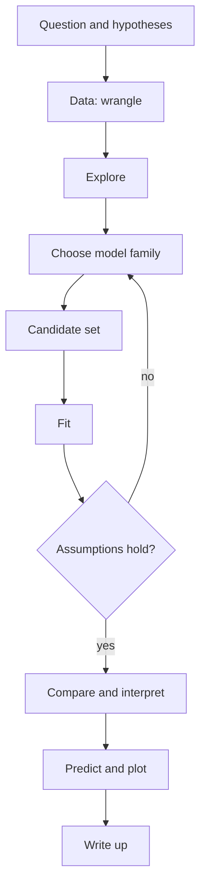

# End-to-end Analysis Plan

**In one line:** an end-to-end analysis plan is the ordered list of steps from the scientific question to the final figure, written down before the analysis starts.

> [!info] Before this, it helps to know
> [[Modeling Process]] (the general cycle) · [[Hypothesis]] (where it starts) · [[Project Folder Structure]] (where the pieces go)

## The everyday picture
A flight plan. The pilot files the route before take-off. Changes are allowed, but each one is a recorded decision, not a drift.

## Start from zero
1. **Question and hypotheses, in words.**
2. **Response, predictors and grouping structure.** What is the sampling unit? What is non-independent?
3. **Get and wrangle the data** by script.
4. **Explore** following the protocol ([[Data Exploration Protocol]]).
5. **Choose the model family** from the response type and structure.
6. **Write the candidate models** from the hypotheses, before fitting ([[Candidate Model Set]]).
7. **Fit, then validate** the global model's assumptions.
8. **Compare or interpret,** with uncertainty.
9. **Predict and plot** on the response scale.
10. **Write methods and results.**
*Why write it first:* each step done after peeking at the results is a chance to fool yourself.

## See it

*What to look at:* the only backward arrow is from validation, not from "I didn't like the result".

## In the course
The Analysis A to Z lab walks this path with the Pine Ridge bird data ([[Course Website]]). The wiki's worked version is the [[Problem-Solving Guide]].

## Common confusions
- **"Explore first, then decide the question."** Exploration checks data quality. Questions come from biology.

## Explain it back
- Which steps must come before looking at model results?

*Pass test:* you can list the stages of an analysis in order and say which are fixed in advance.

## Connections
- **Builds on:** [[Modeling Process]], [[Hypothesis]]
- **Leads to:** [[Problem-Solving Guide]], [[Data Exploration Protocol]], [[Model Validation]]
- **Part of:** [[MOC 12 - Reproducible Coding and Figures|MOC - Reproducible Coding and Figures]]

## Flashcards

What are the main stages of an analysis from start to finish?
??
Question, data wrangling, exploration, model choice, candidate set, fitting, validation, interpretation, prediction and plotting, writing.
++++

Why write the plan before analysing?
??
Decisions made after seeing results are biased toward the result you hoped for.
++++
