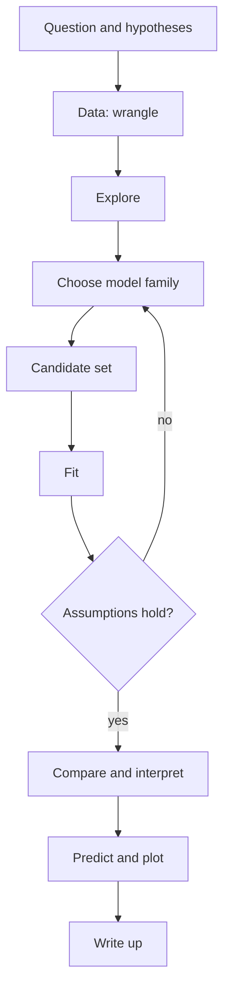

# End-to-end Analysis Plan

A pilot files a flight plan before take-off; changes are allowed, but each is a recorded decision, not a drift. An **end-to-end analysis plan** is the ordered list of steps from the scientific question to the final figure, written down before the analysis starts ([[Modeling Process]]). The steps are: the question and hypotheses, in words ([[Hypothesis]]); the response, predictors and grouping structure, including what the sampling unit is and what is non-independent; getting and wrangling the data by script; exploring, following the [[Data Exploration Protocol]]; choosing the model family from the response type and structure; writing the [[Candidate Model Set]] from the hypotheses, before fitting; fitting, then validating the global model's assumptions ([[Model Validation]]); comparing or interpreting, with uncertainty; predicting and plotting on the response scale; and writing methods and results.

In the flowchart the only backward arrow is from validation to the choice of model family, not from "I didn't like the result". The Analysis A to Z lab walks this path with the Pine Ridge bird data, and the wiki's worked version is the [[Problem-Solving Guide]] ([[Course Website]], [[Project Folder Structure]]).

It is written first because each step done after peeking at the results is a chance to fool yourself. The common reversal is to explore first and then decide the question. Exploration checks data quality; questions come from biology.

*What to look at:* the only backward arrow is from validation, not from "I didn't like the result".

## Connections
- **Builds on:** [[Modeling Process]], [[Hypothesis]]
- **Leads to:** [[Problem-Solving Guide]], [[Data Exploration Protocol]], [[Model Validation]]
- **Part of:** [[MOC 12 - Reproducible Coding and Figures|MOC - Reproducible Coding and Figures]]

## Flashcards

What are the main stages of an analysis from start to finish?
??
Question, data wrangling, exploration, model choice, candidate set, fitting, validation, interpretation, prediction and plotting, writing.
++++

Why write the plan before analysing?
??
Decisions made after seeing results are biased toward the result you hoped for.
++++
