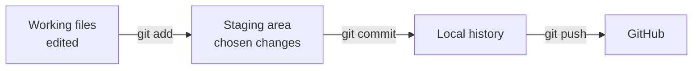

# Git

Picture a camera on a tripod pointed at your project folder. It photographs the folder only when you press the shutter, files each photo with your caption, and never uploads anything by itself. **Git** is that camera: the [[Version Control]] program that runs on your own computer and keeps the history of a project folder, called a [[Repository]]. The history is stored in a hidden `.git` folder inside it.

Recording a snapshot takes two steps. First you choose which changes go into the next snapshot, called *staging* (`git add`); then you take the snapshot with a message (`git commit`), creating a [[Commit]]. Everything so far is local, so Git works offline and nothing is shared until you choose to *push* to a host such as [[GitHub]]; the diagram shows add, commit and push as three separate steps. RStudio has a Git pane with buttons for each, so the command line is optional. A [[gitignore File]] tells Git which files never to track.

Two confusions are common. Git and GitHub are not the same: Git is the tool on your machine, and GitHub is a website that hosts copies ([[Git vs GitHub]]). And saving a file does not commit it: saving changes the working file, while committing records a snapshot in the history. Git is on the Getting Started menu of the [[Course Website]].

*What to look at:* add, commit, push are three separate steps.

## Connections
- **Builds on:** [[Version Control]]
- **Leads to:** [[Commit]], [[GitHub]], [[Repository]], [[gitignore File]]
- **Part of:** [[MOC 03 - R for Ecological Modeling|MOC - R for Ecological Modeling]], molecular note [[Git vs GitHub]]

## Flashcards

What is Git?
??
A version control program that records the history of a project folder on your own computer.
++++

What is the difference between saving a file and committing?
??
Saving updates the working file. Committing records a labelled snapshot in the history.
++++
