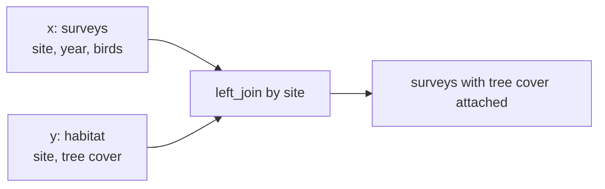

# Joins

**In one line:** a join combines two tables side by side by matching rows that share a key, such as the same site code.

> [!info] Before this, it helps to know
> [[Data Frame]] (the tables) · [[Tidy Data]] (one table per kind of thing)

## The everyday picture
Matching name tags to a guest list. Each guest (row in table one) is looked up on the list (table two) by name, and their table number is copied onto the tag. Guests not on the list get a blank.

## Start from zero
1. **Find the key:** the column both tables share.
2. **`left_join(x, y, by = "key")` keeps every row of x** and adds y's columns where the key matches. No match gives `NA`.
3. **`inner_join` keeps only matched rows. `full_join` keeps everything. `anti_join` shows what failed to match.**
4. **Check the row count after joining.** *Why:* if a key appears twice in y, rows of x are duplicated. If keys are spelled differently, matches fail silently.
5. **Typical case:** many bird surveys per site joined to one row of habitat data per site.

## See it

*What to look at:* the many-rows table goes on the left, the one-row-per-site table on the right.

## In R
```r
library(dplyr)
birds <- data.frame(site = c("A", "A", "B", "C"), year = c(1, 2, 1, 1), n = c(9, 8, 6, 5))
land  <- data.frame(site = c("A", "B", "D"), tree = c(10, 30, 60))
left_join(birds, land, by = "site")      # C gets NA tree cover
inner_join(birds, land, by = "site")     # C dropped
anti_join(birds, land, by = "site")      # which surveys have no habitat row?
nrow(birds); nrow(left_join(birds, land, by = "site"))   # row count unchanged: good
```

## In the course
Homework 3 joins two years of bird data to one landscape table for the Mt Lofty Ranges ([[Course Website]]).

## Common confusions
- **"A join stacks tables."** That is binding rows. A join adds columns by matching.
- **"No error means it worked."** Unmatched keys just give NA. Always run an `anti_join()`.

## Explain it back
- What does `left_join` do with rows of x that have no match?
- How can a join create extra rows?

*Pass test:* you can attach site-level covariates to observation-level data and verify the result.

## Connections
- **Builds on:** [[Data Frame]], [[Tidy Data]]
- **Leads to:** [[Binding Rows and Columns]], [[Data Wrangling]], [[Landscape Metrics]]
- **Part of:** [[MOC 03 - R for Ecological Modeling|MOC - R for Ecological Modeling]]

## Flashcards

What does left_join(x, y, by = "key") do?
??
Keeps all rows of x and adds columns from y where the key matches, with NA where it doesn't.
++++

What two checks should follow a join?
??
Compare row counts before and after, and use anti_join() to list unmatched keys.
++++
