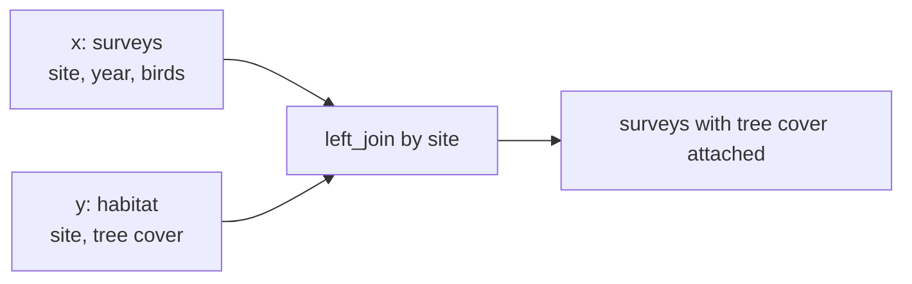

# Joins

Matching name tags to a guest list: each guest is looked up on the list by name and their table number is copied onto the tag, and guests not on the list get a blank. A **join** combines two tables side by side by matching rows that share a *key*, a column both tables contain, such as a site code ([[Data Frame]]). It is how you keep each kind of information in its own tidy table ([[Tidy Data]]) and bring them together for analysis, for example many bird surveys per site joined to one row of habitat data per site.

`left_join(x, y, by = "site")` keeps every row of x and adds y's columns where the key matches; a row with no match gets `NA`. The other joins differ only in what they keep: `inner_join()` keeps only matched rows, `full_join()` keeps everything from both, and `anti_join()` returns the rows of x that failed to match. In the example below, site C has surveys but no habitat row, so the left join gives it `NA` tree cover, the inner join drops it, and the anti join shows it. Homework 3 joins two years of bird data to one landscape table for the Mount Lofty Ranges this way ([[Course Website]], [[Landscape Metrics]]).

Joins fail quietly, so check them. If a key appears twice in y, rows of x are duplicated; if keys are spelled differently ("A" and "a"), matches fail and give `NA` without any error. Compare the row count before and after a left join, as the last line does, and run an `anti_join()` to see what did not match. A join is not stacking tables: gluing tables by position is [[Binding Rows and Columns]], which does no matching at all ([[Data Wrangling]]).


*What to look at:* the many-rows table goes on the left, the one-row-per-site table on the right.

```r
library(dplyr)
birds <- data.frame(site = c("A", "A", "B", "C"), year = c(1, 2, 1, 1), n = c(9, 8, 6, 5))
land  <- data.frame(site = c("A", "B", "D"), tree = c(10, 30, 60))
left_join(birds, land, by = "site")      # C gets NA tree cover
inner_join(birds, land, by = "site")     # C dropped
anti_join(birds, land, by = "site")      # which surveys have no habitat row?
nrow(birds); nrow(left_join(birds, land, by = "site"))   # row count unchanged: good
```

## Connections
- **Builds on:** [[Data Frame]], [[Tidy Data]]
- **Leads to:** [[Binding Rows and Columns]], [[Data Wrangling]], [[Landscape Metrics]]
- **Part of:** [[MOC 03 - R for Ecological Modeling|MOC - R for Ecological Modeling]]

## Flashcards

What does left_join(x, y, by = "key") do?
??
Keeps all rows of x and adds columns from y where the key matches, with NA where it doesn't.
++++

What two checks should follow a join?
??
Compare row counts before and after, and use anti_join() to list unmatched keys.
++++
