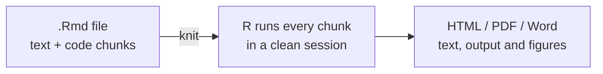

# R Markdown

**In one line:** R Markdown is a file format that mixes plain writing with runnable R code, so the report and the analysis that produced it are one document.

> [!info] Before this, it helps to know
> [[Script]] (code only) · [[Reproducibility]] (why results and code should travel together)

## The everyday picture
A lab notebook that redoes its own experiments. Each time you open it, every number, table and figure is recalculated from the data, so the text can never drift out of step with the results.

## Start from zero
1. **The file has three parts.** A header between `---` lines (title, output type), ordinary text written in Markdown, and code chunks.
2. **Markdown is simple text formatting.** `#` heading, `*italic*`, `**bold**`, `-` list.
3. **Chunks hold R code** between ```` ```{r} ```` and ```` ``` ```` ([[Code Chunks]]).
4. **Knitting runs everything top to bottom in a fresh session** and builds an HTML, PDF or Word file ([[Knitting]]).
5. **Why not copy and paste results into Word?** Because when the data change, pasted numbers silently become wrong.
6. **Inline code puts a computed number in a sentence:** `` `r mean(x)` ``.

## See it

*What to look at:* one source file, one button, one finished report.

## In the course
The Getting Started pages include an intro to R Markdown, and homework is submitted as knitted documents ([[Course Website]]; [[Homework]]).

## Common confusions
- **"It ran chunk by chunk, so it will knit."** Knitting starts with an empty environment. Objects you made in the console don't exist there.
- **"Rmd and Quarto are unrelated."** Quarto (`.qmd`) is the newer sibling with nearly the same syntax.

## Explain it back
- What are the three parts of an Rmd file?
- Why does a knitted report prove more than a script that "ran for me"?

*Pass test:* you can describe what happens when you press Knit.

## Connections
- **Builds on:** [[Script]]
- **Leads to:** [[Code Chunks]], [[Knitting]], [[kable()]]
- **Part of:** [[MOC 03 - R for Ecological Modeling|MOC - R for Ecological Modeling]]

## Flashcards

What is R Markdown?
??
A document format combining text and runnable R code, rendered into a report whose results are regenerated each time.
++++

What are the three parts of an Rmd file?
??
A YAML header, Markdown text, and R code chunks.
++++
