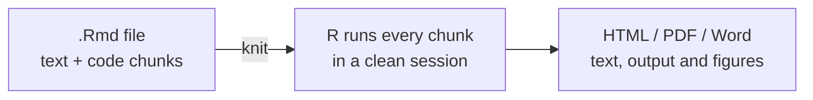

# R Markdown

Imagine a lab notebook that redoes its own experiments: each time you open it, every number, table and figure is recalculated from the data, so the text can never drift out of step with the results. **R Markdown** is a file format (`.Rmd`) that works like that. It mixes plain writing with runnable R code, so the report and the analysis that produced it are one document. Where a [[Script]] holds code only, an R Markdown file holds the whole story: the question, the code, its output and your interpretation.

A file has three parts. A header between two `---` lines gives the title and the output type. The text is written in *Markdown*, a simple formatting language where `#` starts a heading, `*italic*` and `**bold**` style words, and `-` starts a list item. And *code chunks*, fenced blocks of R code, sit wherever results are needed ([[Code Chunks]]). Inline code puts a computed number straight into a sentence, so `` `r mean(x)` `` prints the mean itself. Pressing Knit runs every chunk from top to bottom in a fresh R session and builds a finished HTML, PDF or Word file, as the diagram shows ([[Knitting]]). Tables are formatted with functions such as [[kable()]].

Why not copy results into a word processor? Because when the data change, pasted numbers silently become wrong, and nobody can tell which version of the analysis they came from. With R Markdown, rerunning the document updates everything at once, which is why it is a cornerstone of [[Reproducibility]] and why homework in the course is submitted as knitted documents ([[Homework]], [[Course Website]]). Note that running chunks one by one in your session is not the same as knitting: knitting starts with an empty environment, so objects you made in the [[Console|console]] do not exist there. Quarto (`.qmd`) is the newer sibling of R Markdown, with nearly the same syntax.

*What to look at:* one source file, one button, one finished report.

## Connections
- **Builds on:** [[Script]], [[Console]]
- **Leads to:** [[Code Chunks]], [[Knitting]], [[kable()]]
- **Part of:** [[MOC 03 - R for Ecological Modeling|MOC - R for Ecological Modeling]]

## Flashcards

What is R Markdown?
??
A document format combining text and runnable R code, rendered into a report whose results are regenerated each time.
++++

What are the three parts of an Rmd file?
??
A YAML header, Markdown text, and R code chunks.
++++
