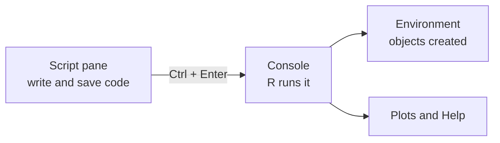

# R and RStudio

Think of a car. R is the engine: it does all the work and could, in principle, run on its own. RStudio is the dashboard, steering wheel and seats: it adds no power but makes driving bearable. **R** is the programming language that does the statistics: you type instructions and it computes and answers. **RStudio** (made by the company Posit) is the workbench program wrapped around R. You install both, but you only ever open RStudio, and it runs R for you behind the scenes. Both are free, so anyone can rerun your analysis without buying software.

RStudio splits the screen into four panes. Top left is the script editor, where you write and save code ([[Script]]). Bottom left is the [[Console]], where R actually runs each command and prints the answer. Top right is the environment, a list of the objects you have created ([[Objects and Assignment]]), and bottom right holds files, plots and help pages. The everyday rhythm is: write a line in the script, press Ctrl + Enter (Cmd + Enter on a Mac), and watch it run in the console, as in the small example below where `mean(x)` returns 9. Extra abilities, such as fitting [[Mixed Effects Model|mixed models]], come as add-on [[Packages in R]].

Why bother with typed code rather than menus? Because a script is a saved, rerunnable record of every step, which is what makes an analysis repeatable and checkable ([[Reproducibility]]). Two common confusions. RStudio is not R: it is only the editor, so in a [[Writing Methods Sections|methods section]] you cite R and the packages you used, not RStudio. And although you *can* type straight into the console, work typed there is not saved; anything you will need again belongs in a script. The course's Getting Started pages cover installing both ([[Course Website]]), and the textbooks assume R throughout ([[Zuur et al. 2009 Appendix A]]).


*What to look at:* code flows from the script to the console, and results appear on the right.

```r
1 + 1                  # R as a calculator
x <- c(4, 8, 15)       # store three numbers under the name x
mean(x)                # 9
R.version.string       # which R you are running
```
Run a line by placing the cursor on it and pressing Ctrl + Enter (Cmd + Enter on a Mac).

## Connections
- **Leads to:** [[Console]], [[Script]], [[Objects and Assignment]], [[Packages in R]], [[Mixed Effects Model]], [[Writing Methods Sections]]
- **See also:** [[Model]]
- **Part of:** [[MOC 03 - R for Ecological Modeling|MOC - R for Ecological Modeling]]

## Flashcards

What is the difference between R and RStudio?
??
R is the language that computes. RStudio is an editor that makes R easier to use.
++++

Which keys run the current line of a script?
??
Ctrl + Enter, or Cmd + Enter on a Mac.
++++
