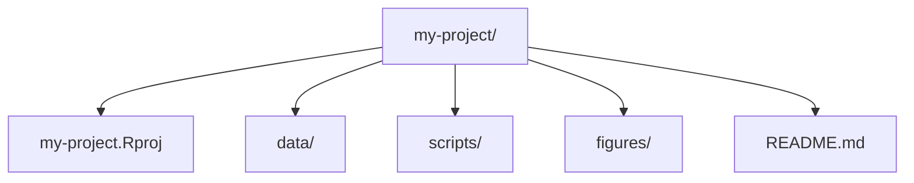

# RProject

A labelled toolbox for one job holds everything for that job and nothing from other jobs; hand it to someone else and they have all they need. An **RProject** is a folder marked with an `.Rproj` file. Create one with File > New Project in RStudio. Double-clicking the `.Rproj` file opens RStudio with a fresh R session and the [[Working Directory]] set to that folder, so [[Relative Path|relative paths]] work with no `setwd()`: "here" is now the same place for everyone who opens the project.

Each project gets its own session, history and open files, so thesis and coursework do not contaminate each other. The flowchart shows a typical layout, with the `.Rproj` file at the top marking the root beside the data, scripts and figures folders and a README ([[Project Folder Structure]]). Turn off "restore .RData at startup" in Global Options, so every session starts empty, and pair the project with a Git [[Repository]].

The 24 September session covers RProjects, and the project instructions require submitting one ([[Course Website]], [[Final Project]], [[Reproducibility]]). Two confusions. The `.Rproj` file does not contain your code; it holds a few settings, and its job is to mark the folder. And opening a script directly does not set the working directory, so open the project, not the script. Inside a project, [[here()]] builds paths that work from any subfolder.

*What to look at:* the .Rproj file sits at the top and marks the root.

## Connections
- **Builds on:** [[Working Directory]], [[Relative Path]]
- **Leads to:** [[here()]], [[Project Folder Structure]], [[Reproducibility]]
- **Part of:** [[MOC 12 - Reproducible Coding and Figures|MOC - Reproducible Coding and Figures]], molecular note [[Why a reproducible project structure saves you]]

## Flashcards

What is an RProject?
??
A folder containing an .Rproj file. Opening it starts a fresh R session with that folder as the working directory.
++++

Why do RProjects make setwd() unnecessary?
??
The working directory is set to the project folder automatically, so relative paths work for anyone.
++++
