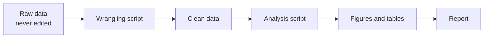

# Reproducibility

A dish made "with a pinch of this until it looks right" dies with the cook; a dish with a written recipe can be made by anyone, tasted by critics and improved. Science only counts the second kind. An analysis is **reproducible** when someone else, given your data and code, gets exactly your results by running it. That means every result traces back to code, not to clicks or hand edits ([[Script]]); the code runs from raw data to final figure in a clean session; and it does not depend on your computer, so no personal paths, no manually installed extras and no objects left in memory. Random steps need a seed ([[Random Numbers and set.seed()]]), and software versions should be recorded ([[Session Info]]).

The flowchart shows the chain: raw data that are never edited, a wrangling script, clean data, an analysis script, figures and tables, and the report. Every arrow is code, so the whole chain can be rerun. The practical pieces are an [[RProject]] with paths built by [[here()]], a standard [[Project Folder Structure]], and [[Version Control]] to record changes.

It is required, not just nice, because errors in analyses are common and invisible, and reproducibility is what lets you, a reviewer or a grader find them. The first person it saves is you, six months later. The course grades the final project on whether the code runs start to finish on another machine, and two sessions, 24 and 29 September, are devoted to it ([[Final Project]], [[Course Website]]). Two confusions. Reproducible does not mean correct: a reproducible analysis can still be wrong, but only a reproducible one can be shown to be wrong and fixed. And reproducibility is not replication: replication repeats the study with new data, while reproducibility reruns the same data and code.

*What to look at:* every arrow is code, so the whole chain can be rerun.

## Connections
- **Builds on:** [[Script]]
- **Leads to:** [[RProject]], [[here()]], [[Project Folder Structure]], [[Version Control]]
- **See also:** [[Scientific Method]]
- **Part of:** [[MOC 12 - Reproducible Coding and Figures|MOC - Reproducible Coding and Figures]], molecular note [[Why a reproducible project structure saves you]]

## Flashcards

What does reproducible mean for an analysis?
??
Someone else can run your code on your data and get exactly your results.
++++

How does reproducibility differ from replication?
??
Reproducibility reruns the same data and code. Replication repeats the study with new data.
++++
