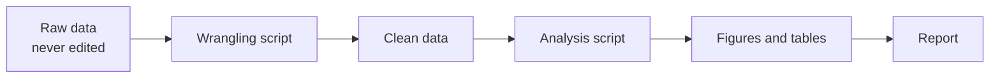

# Reproducibility

**In one line:** an analysis is reproducible when someone else, given your data and code, gets exactly your results by running it.

> [!info] Before this, it helps to know
> [[Script]] (a rerunnable record) · [[Scientific Method]] (why results must be checkable)

## The everyday picture
A recipe versus "a pinch of this until it looks right". A dish made by feel dies with the cook. A dish with a written recipe can be made by anyone, tasted by critics, and improved. Science only counts the second kind.

## Start from zero
1. **Every result must trace back to code,** not to clicks or hand edits.
2. **The code must run from raw data to final figure in a clean session.**
3. **It must not depend on your computer.** No personal paths, no manually installed extras, no objects left in memory.
4. **Random steps need a seed** ([[Random Numbers and set.seed()]]).
5. **Software versions should be recorded** ([[Session Info]]).
6. **Why it is required, not just nice:** errors in analyses are common and invisible. Reproducibility is what lets you, a reviewer or a grader find them. The first person it saves is you, six months later.

## See it

*What to look at:* every arrow is code, so the whole chain can be rerun.

## In the course
The syllabus grades the project on whether the code runs start to finish on another machine ([[Final Project]]). Two sessions (Sep 24, 29) are devoted to it ([[Course Website]]).

## Common confusions
- **"Reproducible means correct."** A reproducible analysis can still be wrong. But only a reproducible one can be shown to be wrong, and fixed.
- **"Replication is the same thing."** Replication repeats the study with new data. Reproducibility reruns the same data and code.

## Explain it back
- Name four things that make a script fail on someone else's computer.
- Who benefits first from a reproducible project?

*Pass test:* you can list what a stranger needs to rerun your analysis.

## Connections
- **Builds on:** [[Script]]
- **Leads to:** [[RProject]], [[here()]], [[Project Folder Structure]], [[Version Control]]
- **Part of:** [[MOC 12 - Reproducible Coding and Figures|MOC - Reproducible Coding and Figures]], molecular note [[Why a reproducible project structure saves you]]

## Flashcards

What does reproducible mean for an analysis?
??
Someone else can run your code on your data and get exactly your results.
++++

How does reproducibility differ from replication?
??
Reproducibility reruns the same data and code. Replication repeats the study with new data.
++++
