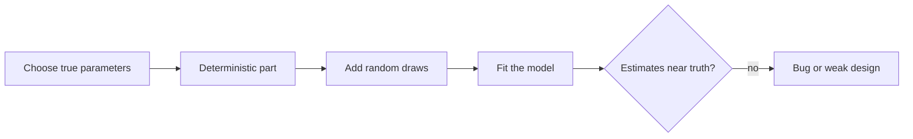

# Simulating Data

A pilot practises engine failure in a flight simulator, where it is safe and the "truth" is known. If they cannot land the simulator, they should not fly the plane. **Simulating data** means inventing a dataset from a model whose true parameters you chose, so you can see whether your analysis recovers them. The recipe follows the model itself: choose true values (say intercept 2, slope 0.5, residual SD 1), make the predictor values, compute the [[Deterministic Component]] (mu = 2 + 0.5x), add randomness from the [[Stochastic Component]] (here `rnorm(n, mu, 1)`), then fit the model and compare the estimates with the truth.

The example below does this for three model types. For a linear model, `lm()` returns estimates near 2 and 0.5. For counts, the deterministic part goes through `exp()` and the noise is Poisson, and a Poisson GLM returns estimates near 0.2 and 0.15. For grouped data, each of 10 sites gets its own intercept drawn from a normal distribution, the structure a mixed model assumes. Every model in the course can be simulated from by following its own equation, and the randomness is made repeatable with [[Random Numbers and set.seed()|set.seed()]] ([[Distribution Functions in R]]).

Simulation is so valuable because it is the only situation in which you know the right answer. It checks that model code works, Hobbs and Hooten's recommended habit before trusting any Bayesian model; it shows how much data a design needs to detect an effect; and it makes a method's behaviour visible. Simulated data are a test rig, not a result. Recovering the truth shows the code works *when the model is true*; it does not show the model is right for your real data, whose assumptions may still fail. The same machinery underlies the [[Parametric Bootstrap]], and almost every R example in this wiki uses it.


*What to look at:* the loop ends in a comparison you can never make with real data.

```r
set.seed(10)
n <- 100; x <- runif(n, 0, 10)
y <- rnorm(n, mean = 2 + 0.5 * x, sd = 1)          # linear model
coef(lm(y ~ x))                                    # near 2 and 0.5
count <- rpois(n, lambda = exp(0.2 + 0.15 * x))    # Poisson GLM
coef(glm(count ~ x, family = poisson))             # near 0.2 and 0.15
# grouped data: 10 sites, each with its own intercept
site <- rep(1:10, each = 10); a <- rnorm(10, 0, 2)
y2 <- rnorm(n, 2 + a[site] + 0.5 * x, 1)
```
Every model in the course can be simulated from by following its own equation.

## Connections
- **Builds on:** [[Random Numbers and set.seed()]], [[Deterministic Component]], [[Stochastic Component]]
- **Leads to:** [[Distribution Functions in R]], [[Parametric Bootstrap]]
- **See also:** [[Simulating Data|Simulated Data to Check Model Code]]
- **Part of:** [[MOC 03 - R for Ecological Modeling|MOC - R for Ecological Modeling]]

## Flashcards

Why simulate data from a known model?
??
It is the only setting where the true parameters are known, so you can check whether the analysis recovers them.
++++

What are the steps to simulate regression data?
??
Choose parameters, create predictors, compute the deterministic mean, then draw the response from a distribution around it.
++++
