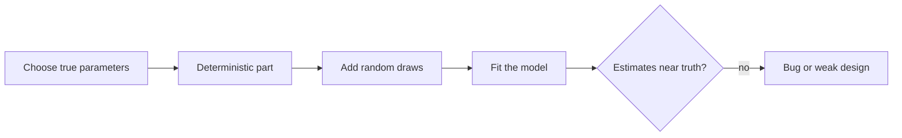

# Simulating Data

**In one line:** simulating data means inventing a dataset from a model whose true parameters you chose, so you can see whether your analysis recovers them.

> [!info] Before this, it helps to know
> [[Random Numbers and set.seed()]] (repeatable randomness) · [[Deterministic Component]] (the rule) · [[Stochastic Component]] (the noise)

## The everyday picture
A flight simulator. A pilot practises engine failure where it is safe and the "truth" is known. If they can't land the simulator, they shouldn't fly the plane. If your model can't recover parameters from fake data, don't trust it on real data.

## Start from zero
1. **Choose true parameter values.** Intercept 2, slope 0.5, SD 1.
2. **Make the predictors.**
3. **Compute the deterministic part.** mu = 2 + 0.5 x.
4. **Add randomness from a distribution.** `rnorm(n, mu, 1)`, or `rpois(n, exp(...))` for counts.
5. **Fit the model and compare with the truth.**
6. **Why it is so valuable:** it is the only situation where you know the right answer. It checks code, shows how much data you need, and makes a method's behaviour visible.

## See it

*What to look at:* the loop ends in a comparison you can never make with real data.

## In R
```r
set.seed(10)
n <- 100; x <- runif(n, 0, 10)
y <- rnorm(n, mean = 2 + 0.5 * x, sd = 1)          # linear model
coef(lm(y ~ x))                                    # near 2 and 0.5
count <- rpois(n, lambda = exp(0.2 + 0.15 * x))    # Poisson GLM
coef(glm(count ~ x, family = poisson))             # near 0.2 and 0.15
# grouped data: 10 sites, each with its own intercept
site <- rep(1:10, each = 10); a <- rnorm(10, 0, 2)
y2 <- rnorm(n, 2 + a[site] + 0.5 * x, 1)
```
Every model in the course can be simulated from by following its own equation.

## In the course
Hobbs and Hooten recommend simulated data to check model code ([[Simulating Data|Simulated Data to Check Model Code]]). Every R example in this wiki uses it.

## Common confusions
- **"Simulated data are cheating."** They are a test rig, not a result.
- **"If it recovers the truth, the model is right for my data."** It shows the code works when the model is true. Real data may break the assumptions.

## Explain it back
- What are the four steps of simulating from a regression?

*Pass test:* you can simulate from a linear and a Poisson model and recover the parameters.

## Connections
- **Builds on:** [[Random Numbers and set.seed()]], [[Deterministic Component]], [[Stochastic Component]]
- **Leads to:** [[Distribution Functions in R]], [[Simulating Data|Simulated Data to Check Model Code]], [[Parametric Bootstrap]]
- **Part of:** [[MOC 03 - R for Ecological Modeling|MOC - R for Ecological Modeling]]

## Flashcards

Why simulate data from a known model?
??
It is the only setting where the true parameters are known, so you can check whether the analysis recovers them.
++++

What are the steps to simulate regression data?
??
Choose parameters, create predictors, compute the deterministic mean, then draw the response from a distribution around it.
++++
