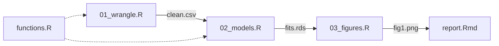

# Splitting Scripts

**In one line:** splitting scripts means giving each stage of the analysis, wrangling, modeling, figures, its own file instead of one giant script.

> [!info] Before this, it helps to know
> [[Script]] (a file of code) · [[Project Folder Structure]] (where they live)

## The everyday picture
Chapters in a book. Nobody wants one 300-page paragraph. Chapters let you find things, rewrite one part without touching the others, and tell at a glance what the book covers.

## Start from zero
1. **One job per script.** Wrangle, explore, model, plot.
2. **Each script reads files and writes files.** Wrangling writes clean data, modeling reads it and writes fitted models, figures read those.
3. **Number them in run order.**
4. **Put reusable functions in their own file** and load it with `source("scripts/functions.R")`.
5. **Why:** a slow model doesn't rerun because you changed a plot colour, and a bug is confined to one small file.
6. **A master script can run them all** in order.

## See it

*What to look at:* scripts talk to each other only through saved files.

## In R
```r
f <- file.path(tempdir(), "functions.R")
writeLines("cv <- function(x) sd(x) / mean(x)", f)   # a functions file
source(f)                                            # load everything defined in it
cv(c(8, 9, 7, 8))
```

## In the course
The syllabus suggests separate scripts for wrangling, analysis and custom functions ([[Final Project]]). The Analysis A to Z lab is in two parts for this reason ([[Course Website]]).

## Common confusions
- **"Scripts can share objects through memory."** That only works in your current session. Pass results through files.

## Explain it back
- How should two scripts hand results to each other?

*Pass test:* you can divide an analysis into numbered scripts with clear inputs and outputs.

## Connections
- **Builds on:** [[Script]], [[Project Folder Structure]]
- **Leads to:** [[Caching Long Runs]], [[Writing Your Own Function]], [[End-to-end Analysis Plan]]
- **Part of:** [[MOC 12 - Reproducible Coding and Figures|MOC - Reproducible Coding and Figures]]

## Flashcards

Why split an analysis into several scripts?
??
Each stage can be rerun, debugged and understood separately, and slow steps aren't repeated needlessly.
++++

What does source("file.R") do?
??
Runs the code in that file, for example to load your own functions.
++++
