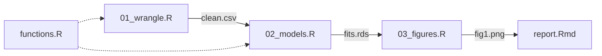

# Splitting Scripts

Nobody wants a book as one 300-page paragraph: chapters let you find things, rewrite one part without touching the others, and see at a glance what the book covers. **Splitting scripts** means giving each stage of the analysis, such as wrangling, exploring, modeling and figures, its own file instead of one giant [[Script]]. Each script reads files and writes files: wrangling writes clean data, modeling reads it and writes fitted models, and the figure script reads those. Number them in run order, and put reusable functions in their own file, loaded with `source("scripts/functions.R")` ([[Writing Your Own Function]]). A master script can run them all in order.

The flowchart shows scripts talking to each other only through saved files, with a shared functions file feeding the first two. The code below writes a one-line functions file defining a [[Coefficient of Variation|coefficient of variation]], loads it with `source()`, and uses the function.

Splitting means a slow model does not rerun because you changed a plot colour, and a bug is confined to one small file ([[Caching Long Runs]]). The syllabus suggests separate scripts for wrangling, analysis and custom functions, which is why the Analysis A to Z lab comes in two parts ([[Final Project]], [[Course Website]], [[Project Folder Structure]], [[End-to-end Analysis Plan]]). Scripts should not share objects through memory, which only works in your current session; pass results through files.


*What to look at:* scripts talk to each other only through saved files.

```r
f <- file.path(tempdir(), "functions.R")
writeLines("cv <- function(x) sd(x) / mean(x)", f)   # a functions file
source(f)                                            # load everything defined in it
cv(c(8, 9, 7, 8))
```

## Connections
- **Builds on:** [[Script]], [[Project Folder Structure]], [[Coefficient of Variation]]
- **Leads to:** [[Caching Long Runs]], [[Writing Your Own Function]], [[End-to-end Analysis Plan]]
- **Part of:** [[MOC 12 - Reproducible Coding and Figures|MOC - Reproducible Coding and Figures]]

## Flashcards

Why split an analysis into several scripts?
??
Each stage can be rerun, debugged and understood separately, and slow steps aren't repeated needlessly.
++++

What does source("file.R") do?
??
Runs the code in that file, for example to load your own functions.
++++
