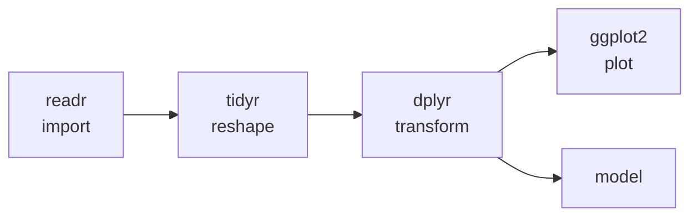

# Tidyverse

A set of kitchen tools from one maker has handles that all fit your hand the same way and lids that fit each other's pots. You could cook with a mismatched drawer, but with a set you stop thinking about the tools. The **tidyverse** is that kind of set for R: a family of packages that share one design, so importing, cleaning, reshaping and plotting data all work the same way ([[Packages in R]]). `library(tidyverse)` loads the core set at once. Each package has one job: readr reads files, tidyr reshapes tables, dplyr transforms them, ggplot2 plots, [[Strings in R|stringr]] handles text, forcats handles factors and [[map()|purrr]] repeats operations.

The shared design is simple. Most functions are verbs, such as `filter()`, `mutate()` and `summarise()`, that take a data frame as their first argument and return a data frame ([[Data Frame]]). Because the output of one verb is the right input for the next, steps chain together with the [[Pipe|Pipe Operator]], and code reads top to bottom as a list of actions. The example below takes a small table of masses, groups it by species and summarises the mean mass of each, in three readable lines. The tools all expect [[Tidy Data]], one variable per column and one observation per row, and the diagram shows how the packages line up as stages from import to plot ([[filter()]], [[ggplot2 Grammar of Graphics]]).

The tidyverse does not replace R; it is a set of packages inside R, and base R functions keep working alongside it. One practical consequence of loading many packages is name clashes: if `filter()` behaves strangely or "isn't found", either the package is not loaded or another package's function of the same name is [[Flood Masking|masking]] it. The course's crash course and its wrangling-to-figures session are built on the tidyverse ([[Course Website]]).


*What to look at:* one package per stage of the wrangling pipeline.

```r
library(tidyverse)
penguins_like <- tibble(species = c("A", "A", "B", "B"), mass = c(3700, 3900, 5000, 5200))
penguins_like |>
  group_by(species) |>
  summarise(mean_mass = mean(mass))
```

## Connections
- **Builds on:** [[Packages in R]], [[Data Frame]], [[Strings in R]], [[map()]]
- **Leads to:** [[Pipe|Pipe Operator]], [[Tidy Data]], [[filter()]], [[ggplot2 Grammar of Graphics]], [[Flood Masking]]
- **Part of:** [[MOC 03 - R for Ecological Modeling|MOC - R for Ecological Modeling]]

## Flashcards

What is the tidyverse?
??
A set of R packages (dplyr, tidyr, ggplot2, readr and others) built on shared design rules.
++++

Which tidyverse packages transform and reshape data?
??
dplyr transforms (filter, mutate, summarise). tidyr reshapes (pivot_longer, pivot_wider).
++++
