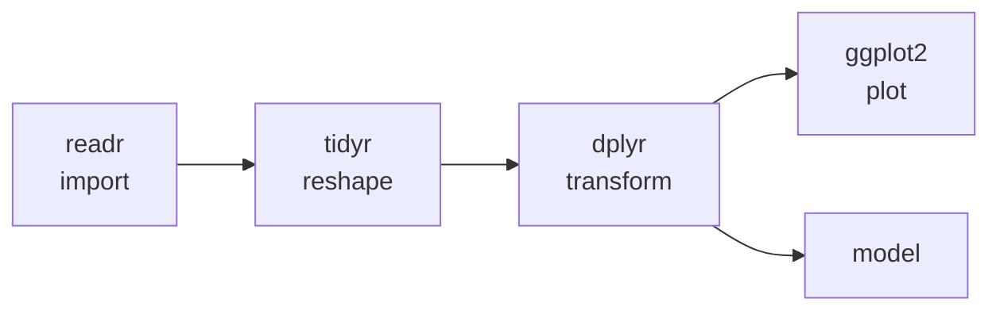

# Tidyverse

**In one line:** the tidyverse is a family of R packages that share one design, so data import, cleaning, reshaping and plotting all work the same way.

> [!info] Before this, it helps to know
> [[Packages in R]] (installing and loading) · [[Data Frame]] (what the tools act on)

## The everyday picture
A set of kitchen tools from one maker. The handles all fit your hand the same way and the lids fit each other's pots. You could cook with a mismatched drawer, but with a set you stop thinking about the tools.

## Start from zero
1. **`library(tidyverse)` loads the core set at once.**
2. **Each package has one job.** readr reads files, dplyr transforms tables, tidyr reshapes, ggplot2 plots, stringr handles text, purrr repeats, forcats handles factors.
3. **Functions are verbs** that take a data frame first and return a data frame.
4. **So steps chain with the pipe** ([[Pipe Operator]]). *Why this design:* code reads top to bottom as a list of actions.
5. **They expect [[Tidy Data]].**

## See it

*What to look at:* one package per stage of the wrangling pipeline.

## In R
```r
library(tidyverse)
penguins_like <- tibble(species = c("A", "A", "B", "B"), mass = c(3700, 3900, 5000, 5200))
penguins_like |>
  group_by(species) |>
  summarise(mean_mass = mean(mass))
```

## In the course
The crash course and the wrangling-to-figures session are tidyverse-based ([[Course Website]]).

## Common confusions
- **"Tidyverse replaces R."** It is a set of packages inside R. Base R still works alongside.
- **"filter() isn't found."** The package isn't loaded, or another package's `filter` is masking it.

## Explain it back
- Name four tidyverse packages and their jobs.

*Pass test:* you can say which package handles reading, reshaping, transforming and plotting.

## Connections
- **Builds on:** [[Packages in R]], [[Data Frame]]
- **Leads to:** [[Pipe Operator]], [[Tidy Data]], [[filter()]], [[ggplot2 Grammar of Graphics]]
- **Part of:** [[MOC 03 - R for Ecological Modeling|MOC - R for Ecological Modeling]]

## Flashcards

What is the tidyverse?
??
A set of R packages (dplyr, tidyr, ggplot2, readr and others) built on shared design rules.
++++

Which tidyverse packages transform and reshape data?
??
dplyr transforms (filter, mutate, summarise). tidyr reshapes (pivot_longer, pivot_wider).
++++
