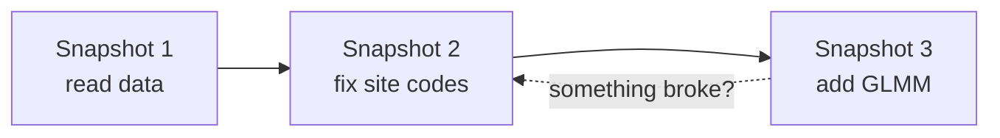

# Version Control

File names such as `thesis_final.docx`, `thesis_final2.docx` and `thesis_REALfinal_v3.docx` are version control done badly. **Version control** is that habit done properly: a system that records every saved state of a project's files, so you can see what changed, when and why, and go back to any earlier state. You work on your files as usual; at meaningful points you save a snapshot with a short message ([[Commit]]); the history is the chain of those snapshots, and any two can be compared or an old one restored.

Scientists need this because analyses change for months. When a result shifts, the history shows exactly which edit did it, as in the diagram where snapshot 3 can be rolled back to snapshot 2. The history is also a backup and a record of who did what. Copies can be synchronised between computers and collaborators ([[Push and Pull]]). The most widely used system is [[Git]], with online copies kept on sites such as [[GitHub]].

Two misconceptions. Cloud sync, such as a shared drive, is not version control: it keeps the latest copy, not a labelled history you control. And version control is not only for teams; its biggest user is your future self, trying to work out what changed since the version that "worked". The course introduces Git in its Getting Started pages and lists version control among good reproducibility practice ([[Course Website]], [[Script]]).

*What to look at:* every snapshot can be returned to.

## Connections
- **Builds on:** [[Script]]
- **Leads to:** [[Git]], [[Commit]], [[GitHub]]
- **See also:** [[Reproducibility]]
- **Part of:** [[MOC 03 - R for Ecological Modeling|MOC - R for Ecological Modeling]]

## Flashcards

What is version control?
??
A system that records snapshots of project files over time so changes can be reviewed and undone.
++++

Why is version control useful for a solo analysis?
??
It shows exactly which change altered a result and lets you return to any earlier state.
++++
