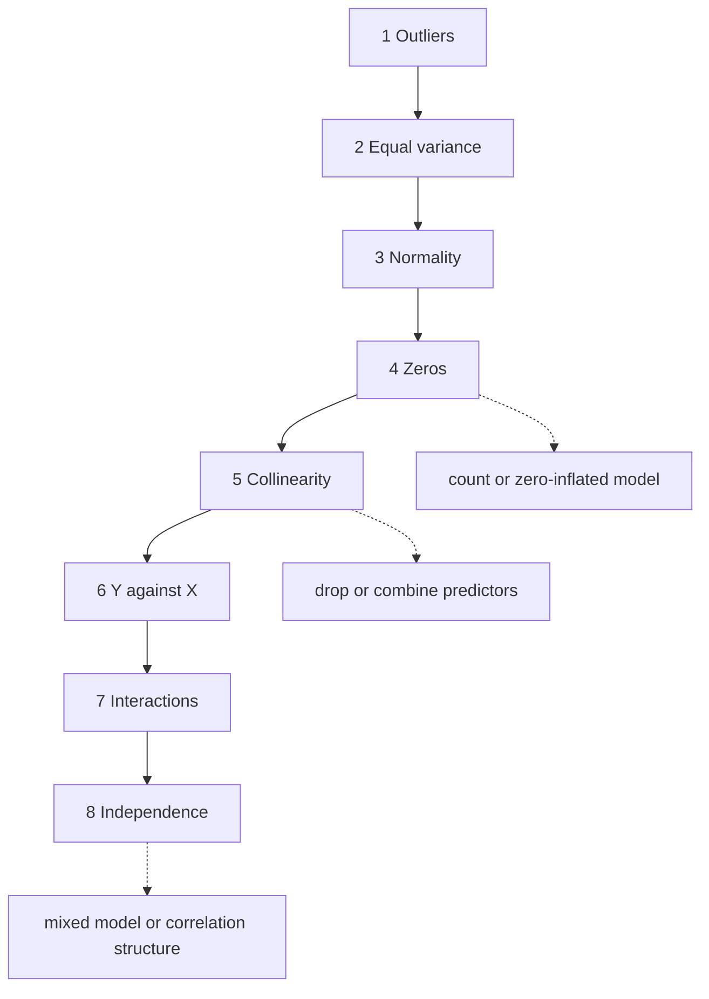

# Data Exploration Protocol

Experienced pilots never skip the pre-flight checklist, because the point of a checklist is to catch the thing you were sure was fine. The **data exploration protocol** is Zuur, Ieno and Elphick's eight-step checklist of things to look at before fitting a model ([[Zuur et al. 2010]], [[Data Exploration]]). In order: (1) outliers in the response Y and the predictors X ([[Outlier]]); (2) homogeneity of variance, whether the spread is similar across groups and along predictors ([[Homogeneity of Variance]]); (3) normality, where the model assumes it ([[Normality]]); (4) zero trouble, how many zeros are in the response ([[Zero Inflation]]); (5) collinearity among the X's ([[Collinearity]]); (6) the shape of the relationships between Y and each X ([[Relationships Between Y and X]]); (7) interactions, whether a Y-X relationship differs between groups ([[Interaction Term]]); and (8) independence of Y, whether observations are grouped or close in space or time ([[Independence of Observations]]).

The order has a logic. Single variables come first, because an outlier or a pile of zeros distorts every later plot. Relationships come next. Dependence comes last because it decides the whole class of model. Three steps point directly at a modeling decision, as the diagram shows: many zeros suggest a count or zero-inflated model, strong collinearity means dropping or combining predictors, and grouped or nearby observations call for a mixed model or a correlation structure. The code below takes one quick look per step on simulated bird-richness data from eight routes: boxplots and a dot chart for outliers, boxplots by route for spread, a histogram for shape, the share of zeros, a correlation between predictors, a scatterplot, a coplot by route, and a table of observations per route.

The protocol is a prompt to think, not a ritual where every step applies to every analysis. Normality matters for a linear model and is irrelevant for a Poisson GLM, and even where it matters the assumption concerns the residuals, the response given the predictors, not the raw response. The course's data exploration lab follows the eight steps in order ([[Course Website]], [[Why explore data before modeling]]).


*What to look at:* three of the steps point directly at a modeling decision.

```r
set.seed(1)
d <- data.frame(tree = runif(80, 0, 60), shrub = runif(80, 0, 30), route = factor(rep(1:8, each = 10)))
d$rich <- rpois(80, exp(2.2 - 0.02 * d$tree + rnorm(8, 0, 0.3)[d$route]))
boxplot(d$rich); dotchart(d$rich)                 # 1 outliers
boxplot(rich ~ route, d)                          # 2 spread by group
hist(d$rich)                                      # 3 shape
mean(d$rich == 0)                                 # 4 share of zeros
cor(d$tree, d$shrub)                              # 5 collinearity
plot(rich ~ tree, d)                              # 6 Y against X
coplot(rich ~ tree | route, d)                    # 7 interactions
table(d$route)                                    # 8 grouping structure
```
Eight quick looks, each answering one question from the list.

## Connections
- **Builds on:** [[Data Exploration]]
- **Leads to:** [[Outlier]], [[Collinearity]], [[Independence of Observations]], [[Zero Inflation]]
- **See also:** [[Explanatory Variable]], [[Response Variable]]
- **Part of:** [[MOC 04 - Data Exploration|MOC - Data Exploration]], molecular note [[Why explore data before modeling]]
- **Go deeper:** [[Zuur et al. 2010]]

## Flashcards

What are the eight steps of Zuur's data exploration protocol?
??
Outliers, homogeneity of variance, normality, zeros, collinearity, Y-X relationships, interactions, independence.
++++

Which protocol step leads to mixed models or correlation structures?
??
Step 8, independence of the response.
++++

Which step can make a normal linear model the wrong choice for counts?
??
Step 4, checking for many zeros.
++++
