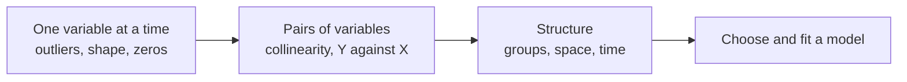

# Data Exploration

**In one line:** data exploration is looking at your data with plots and simple summaries before fitting any model, to catch problems and learn the data's shape.

> [!info] Before this, it helps to know
> [[Inspecting Data]] (the first quick look) · [[Statistical Model]] (what exploration protects)

## The everyday picture
A doctor examining a patient before prescribing. Pulse, temperature, a look at the throat. None of it is the treatment, but prescribing without it is malpractice. Models are the treatment. Exploration is the examination.

*Where the picture stops working:* a doctor examines to find the diagnosis. In data analysis the question should already exist. Exploration checks whether the data can answer it, and shouldn't be used to shop for a finding.

## Start from zero
1. **Every model makes assumptions** about the data's shape and structure.
2. **Software doesn't check them for you.** It fits whatever you give it and prints tidy output either way.
3. **So you look first.** One variable at a time, then pairs, then structure.
4. **Mostly with graphs.** *Why graphs:* a mean and SD can be identical for wildly different data. A plot shows the odd point, the skew, the cluster.
5. **What you find shapes the model.** Counts with many zeros, unequal spread, correlated predictors, grouped observations: each points to a specific tool.
6. **You report it.** Zuur and colleagues argue exploration should be described in the methods.

## See it

*What to look at:* exploration moves from single columns to relationships to dependence.

## Why it is this way
Zuur, Ieno and Elphick wrote their protocol after seeing the same avoidable errors in paper after paper: outliers driving results, correlated predictors, non-independence ignored. Each of these makes standard errors or estimates wrong without any warning. A few plots catch nearly all of them.

## In the course
Aug 25 and 27, with the lab on Loess Canyons bird richness ([[Course Website]]). Reading: [[Zuur et al. 2010]]. Zuur's book says up to half the time of an analysis can go here ([[Zuur et al. 2009 Ch2]]).

## Common confusions
- **"Exploration is finding the significant variables."** That is data dredging. Exploration checks data quality and assumptions.
- **"Diagnostics after fitting are enough."** Many problems are easier to see, and to fix, before.

## Explain it back
- Why do plots beat summary statistics for exploration?
- What is the difference between exploring and dredging?

*Pass test:* you can say what exploration is for and what it is not for.

## Connections
- **Builds on:** [[Inspecting Data]]
- **Leads to:** [[Data Exploration Protocol]], [[Data Dredging|Data Snooping]], [[Model Validation]]
- **Part of:** [[MOC 04 - Data Exploration|MOC - Data Exploration]], molecular note [[Why explore data before modeling]]

## Flashcards

What is data exploration?
??
Examining data with plots and summaries before modeling, to find problems and understand structure.
++++

Why isn't model output enough to reveal data problems?
??
Software fits any data and prints clean results even when assumptions are badly violated.
++++
