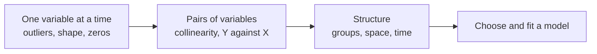

# Data Exploration

A doctor examines a patient before prescribing: pulse, temperature, a look at the throat. None of it is the treatment, but prescribing without it would be malpractice. In analysis, models are the treatment and **data exploration** is the examination: looking at your data with plots and simple summaries before fitting any model, to catch problems and learn the data's shape. It starts where the first quick look at a dataset ends ([[Inspecting Data]]). The question should already exist; exploration checks whether the data can answer it, not which answer to shop for.

The reason is that every [[Statistical Model]] makes assumptions about the data, and software does not check them: it fits whatever you give it and prints tidy output either way. So you look first, mostly with graphs, because a mean and a standard deviation can be identical for wildly different data, while a plot shows the odd point, the skew or the cluster. The work moves from one variable at a time (outliers, shape, zeros), to pairs of variables (correlated predictors, the response against each predictor), to the structure of the data (groups, space, time), as the diagram shows. What you find shapes the model: counts with many zeros, spread that changes, correlated predictors or grouped observations each point to a specific tool, and Zuur, Ieno and Elphick turned this into a checklist ([[Data Exploration Protocol]]).

They wrote it after seeing the same avoidable errors in paper after paper: outliers driving results, correlated predictors, non-independence ignored. Each makes estimates or standard errors wrong without any warning, and a few plots catch nearly all of them ([[Zuur et al. 2010]]). Zuur's book suggests that up to half the time of an analysis can go into this stage, and that it should be reported in the methods ([[Zuur et al. 2009 Ch2]]). Two confusions. Exploration is not hunting for significant variables; that is [[Data Dredging|Data Snooping]], which manufactures false findings. And diagnostics after fitting are not a substitute: many problems are easier to see, and fix, before the model exists, though checking the fitted model still follows ([[Model Validation]], [[Why explore data before modeling]]). The course covers this on 25 and 27 August, with a lab on Loess Canyons bird richness ([[Course Website]]).

*What to look at:* exploration moves from single columns to relationships to dependence.

## Connections
- **Builds on:** [[Inspecting Data]]
- **Leads to:** [[Data Exploration Protocol]], [[Data Dredging|Data Snooping]], [[Model Validation]]
- **Part of:** [[MOC 04 - Data Exploration|MOC - Data Exploration]], molecular note [[Why explore data before modeling]]

## Flashcards

What is data exploration?
??
Examining data with plots and summaries before modeling, to find problems and understand structure.
++++

Why isn't model output enough to reveal data problems?
??
Software fits any data and prints clean results even when assumptions are badly violated.
++++
