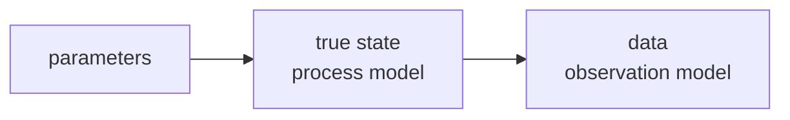

# Chain Rule of Probability

In a relay race, the chance the baton reaches the finish is the chance the first runner completes a leg, times the chance the second does given they received it, times the chance the third does given that. The **chain rule of probability** writes the [[Joint Probability]] of several things as a product of [[Conditional Probability|conditional probabilities]], one link at a time. For two things, P(A, B) = P(A | B) P(B); for three, P(A, B, C) = P(A | B, C) P(B | C) P(C); for any number, keep peeling one off and conditioning on everything that remains. Any order is valid, so choose the one that matches how the process works. It is unrelated to the chain rule of calculus, despite the shared name.

A nest example: P(egg laid, hatches, fledges) = P(laid) × P(hatches | laid) × P(fledges | hatched) = 0.9 × 0.7 × 0.5 = 0.315. The simulation below follows 100,000 eggs through the three stages and gets close to 0.315. The chain simplifies with [[Conditional Independence]]: if fledging depends only on hatching, then P(fledges | hatched, laid) = P(fledges | hatched).

This is exactly how hierarchical models are written. Hobbs and Hooten factor the joint distribution of data y, true state z and parameters θ as P(y, z, θ) = P(y | z) × P(z | θ) × [[Prior Distribution|P(θ)]]: an [[Data Model|observation model]], a [[Process Model|process model]] and priors, each an arrow in the diagram ([[Hierarchical Model]], [[Directed Acyclic Graph]]). Combined with [[Bayes' Theorem]], this factoring is used to write every model in their book ([[Hobbs and Hooten 2015 Ch3]], [[Hobbs and Hooten 2015 Ch6]]).


*What to look at:* each arrow is one conditional factor in the chain.

```r
0.9 * 0.7 * 0.5
set.seed(5); n <- 1e5
laid <- rbinom(n, 1, 0.9); hatch <- rbinom(n, 1, 0.7 * laid); fledge <- rbinom(n, 1, 0.5 * hatch)
mean(fledge)            # close to 0.315
```

## Connections
- **Builds on:** [[Joint Probability]], [[Conditional Probability]]
- **Leads to:** [[Hierarchical Model]], [[Directed Acyclic Graph]], [[Bayes' Theorem]], [[Conditional Independence]], [[Prior Distribution]], [[Data Model]], [[Process Model]]
- **Part of:** [[MOC 05 - Probability and Distributions|MOC - Probability and Distributions]]

## Flashcards

What does the chain rule of probability say for two events?
??
P(A, B) = P(A | B) P(B).
++++

How is a hierarchical model's joint distribution factored?
??
P(data | process) × P(process | parameters) × P(parameters).
++++
