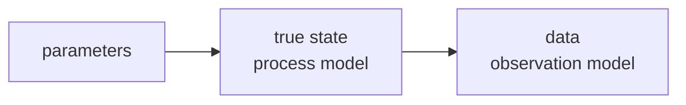

# Chain Rule of Probability

**In one line:** the chain rule of probability writes the joint probability of several things as a product of conditional probabilities, one link at a time.

> [!info] Before this, it helps to know
> [[Joint Probability]] (what is factored) · [[Conditional Probability]] (the factors)

## The everyday picture
A relay race. The chance the baton reaches the finish is the chance the first runner completes a leg, times the chance the second does given they received it, times the chance the third does given that. A long joint event is a chain of "given what came before".

## A tiny example
P(egg laid, hatches, fledges) = P(laid) × P(hatches | laid) × P(fledges | hatched) = 0.9 × 0.7 × 0.5 = 0.315.

## Start from zero
1. **Two things: P(A, B) = P(A | B) P(B).**
2. **Three things: P(A, B, C) = P(A | B, C) P(B | C) P(C).**
3. **Any number: keep peeling one off,** conditioning on everything remaining.
4. **Any order is valid.** Choose the one that matches how the process works.
5. **Simplify with conditional independence.** If A depends only on B, then P(A | B, C) = P(A | B).
6. **Why this is how hierarchical models are written:** P(data, true state, parameters) = P(data | true state) × P(true state | parameters) × P(parameters). Observation model, process model, priors.

## See it

*What to look at:* each arrow is one conditional factor in the chain.

## In R
```r
0.9 * 0.7 * 0.5
set.seed(5); n <- 1e5
laid <- rbinom(n, 1, 0.9); hatch <- rbinom(n, 1, 0.7 * laid); fledge <- rbinom(n, 1, 0.5 * hatch)
mean(fledge)            # close to 0.315
```

## In the course
Hobbs and Hooten call this factoring the joint distribution and use it with diagrams to write every model in the book ([[Hobbs and Hooten 2015 Ch3]]; [[Hobbs and Hooten 2015 Ch6]]).

## Common confusions
- **"It is the chain rule from calculus."** Same name, different rule.

## Explain it back
- Factor P(y, z, θ) in the order data, state, parameters.

*Pass test:* you can factor a three-variable joint probability.

## Connections
- **Builds on:** [[Joint Probability]], [[Conditional Probability]]
- **Leads to:** [[Hierarchical Model]], [[Directed Acyclic Graph]], [[Bayes' Theorem]], [[Conditional Independence]]
- **Part of:** [[MOC 05 - Probability and Distributions|MOC - Probability and Distributions]]

## Flashcards

What does the chain rule of probability say for two events?
??
P(A, B) = P(A | B) P(B).
++++

How is a hierarchical model's joint distribution factored?
??
P(data | process) × P(process | parameters) × P(parameters).
++++
