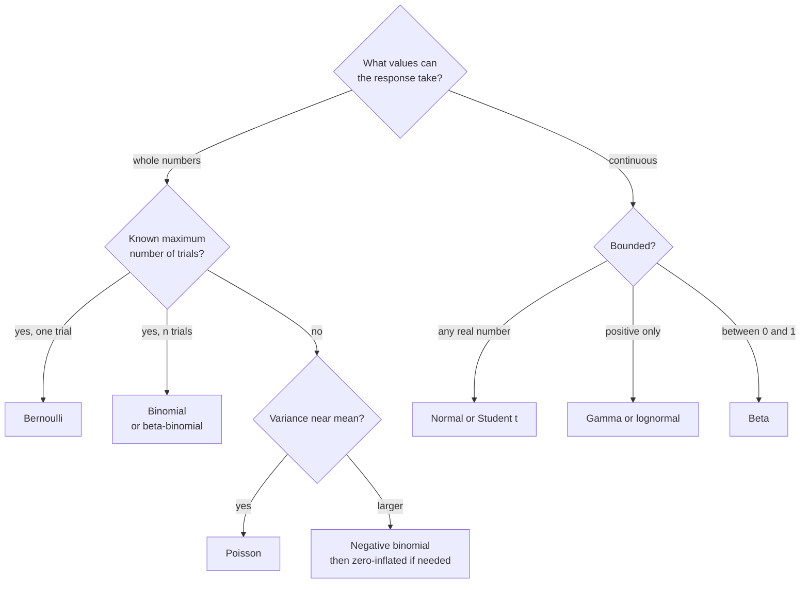

# Choosing a Distribution for Your Response

**In one line:** choosing a distribution means picking the probability distribution whose possible values and mean-variance behaviour match the kind of data your response is.

> [!info] Before this, it helps to know
> [[Support of a Distribution]] (the first filter) · [[Mean-Variance Relationship]] (the second filter) · [[Response Variable]] (what is being matched)

## The everyday picture
Choosing a container. Soup needs a bowl, a sandwich a plate, coffee a cup. You pick by what the thing is, before you've tasted it. Likewise the type of response decides the distribution before you look at any histogram.

## Start from zero
1. **Ask how the response was produced** and what values it could possibly take.
2. **Any real number, symmetric scatter:** normal.
3. **Positive and continuous, spread growing with the mean:** gamma or lognormal.
4. **Yes or no:** Bernoulli.
5. **Successes out of a known number of trials:** binomial. If more variable than that, beta-binomial.
6. **Counts with no upper limit:** Poisson. If more variable, negative binomial. If excess zeros remain, zero-inflated or hurdle.
7. **Continuous proportion strictly between 0 and 1:** beta.
8. **Counts across several categories:** multinomial.
9. **Then check, don't assume.** Fit, simulate from the fitted model and compare with the data.
10. **Why choose from the data's nature and not from a histogram:** the distribution applies to the response given the predictors. A raw histogram mixes the two.

## See it

*What to look at:* two questions, about support and then about spread, lead to nearly every family used in this course.

## In R
```r
set.seed(22); y <- rnbinom(300, mu = 3, size = 0.8)
c(mean = mean(y), var = var(y), zeros = mean(y == 0))           # variance far above mean: not Poisson
c(poisson = AIC(glm(y ~ 1, family = poisson)), negbin = AIC(MASS::glm.nb(y ~ 1)))
```

## In the course
The decision tree in the GLM lectures ([[Course Website]]), following [[Zuur et al. 2009 Ch8]] and [[Hobbs and Hooten 2015 Ch3]].

## Common confusions
- **"Test the response for normality, then decide."** Decide from the data type first.
- **"Transform counts and use a normal."** A count model respects zeros, whole numbers and the mean-variance rule.

## Explain it back
- Which distribution for: clutch size, nest success (yes/no), percent cover, biomass?

*Pass test:* you can assign a sensible distribution to five different ecological responses.

## Connections
- **Builds on:** [[Support of a Distribution]], [[Mean-Variance Relationship]]
- **Leads to:** [[Generalized Linear Model]], [[Posterior Predictive Check]], [[Overdispersion]], [[Beta-binomial Distribution]]
- **Part of:** [[MOC 05 - Probability and Distributions|MOC - Probability and Distributions]], molecular note [[Why the response type decides the distribution]]

## Flashcards

What two properties guide the choice of a response distribution?
??
The support (possible values) and the mean-variance relationship.
++++

Which distributions suit unbounded counts?
??
Poisson, or negative binomial if overdispersed.
++++

Which distribution suits a positive, right-skewed continuous response?
??
Gamma or lognormal.
++++

Which distribution suits a continuous proportion between 0 and 1?
??
Beta.
++++
