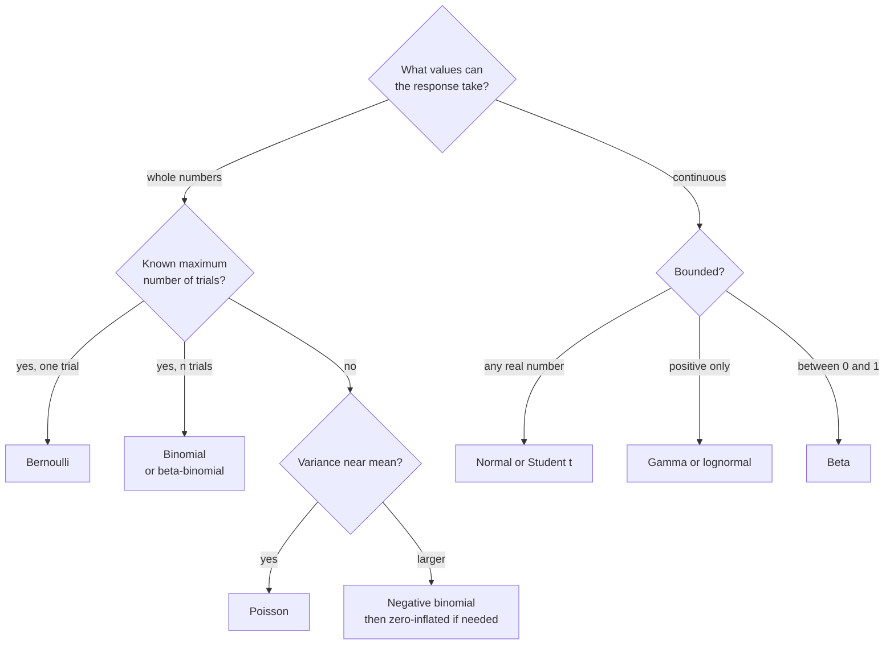

# Choosing a Distribution for Your Response

Soup goes in a bowl, a sandwich on a plate, coffee in a cup: you pick the container by what the thing is, before tasting it. **Choosing a distribution** for a model's response works the same way. You pick the probability distribution whose possible values and spread behaviour match the kind of data your [[Response Variable]] is. Two questions do almost all the work. First, what values can the response take, its [[Support of a Distribution|support]]? Second, how does its spread change with its mean ([[Mean-Variance Relationship]])?

The flowchart lays out the answers used in this course. Any real number with symmetric scatter: normal (or Student t for heavy tails). Positive and continuous, with spread growing with the mean: gamma or lognormal. Yes or no: Bernoulli. Successes out of a known number of trials: binomial, or the [[Beta-binomial Distribution|beta-binomial]] if more variable than that. Counts with no upper limit: Poisson; if more variable, negative binomial; if excess zeros remain, zero-inflated or hurdle. A continuous proportion strictly between 0 and 1: beta. Counts across several categories: multinomial. So clutch size is a count, nest success is Bernoulli, percent cover is beta, and biomass is gamma. In the code below, simulated counts have variance far above the mean, and the negative binomial beats the Poisson by a wide margin in AIC ([[Overdispersion]]).

Decide from the nature of the data, not from a histogram of the raw response. The distribution applies to the response *given the predictors*, and a raw histogram mixes the two, so a "non-normal" histogram may come from perfectly normal errors around a varying mean. Equally, transforming counts and using a normal is a poor substitute for a count model, which respects zeros, whole numbers and the mean-variance rule. Then check rather than assume: fit, simulate from the fitted model and compare with the data ([[Posterior Predictive Check]]). This choice is the first step of every [[Generalized Linear Model]] ([[Zuur et al. 2009 Ch8]], [[Hobbs and Hooten 2015 Ch3]]).


*What to look at:* two questions, about support and then about spread, lead to nearly every family used in this course.

```r
set.seed(22); y <- rnbinom(300, mu = 3, size = 0.8)
c(mean = mean(y), var = var(y), zeros = mean(y == 0))           # variance far above mean: not Poisson
c(poisson = AIC(glm(y ~ 1, family = poisson)), negbin = AIC(MASS::glm.nb(y ~ 1)))
```

## Connections
- **Builds on:** [[Support of a Distribution]], [[Mean-Variance Relationship]]
- **Leads to:** [[Generalized Linear Model]], [[Posterior Predictive Check]], [[Overdispersion]], [[Beta-binomial Distribution]]
- **Part of:** [[MOC 05 - Probability and Distributions|MOC - Probability and Distributions]], molecular note [[Why the response type decides the distribution]]

## Flashcards

What two properties guide the choice of a response distribution?
??
The support (possible values) and the mean-variance relationship.
++++

Which distributions suit unbounded counts?
??
Poisson, or negative binomial if overdispersed.
++++

Which distribution suits a positive, right-skewed continuous response?
??
Gamma or lognormal.
++++

Which distribution suits a continuous proportion between 0 and 1?
??
Beta.
++++
