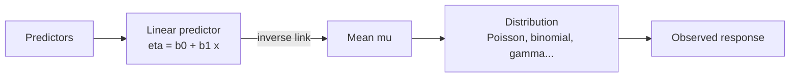

# Generalized Linear Model

A travel adaptor kit lets the same appliance work in every country: the appliance stays the same, and you pick the plug that fits the local socket. A **generalized linear model** (GLM) is that kit for regression. The appliance is the familiar regression equation; the sockets are kinds of response, such as counts, yes/no outcomes and positive amounts. A [[Linear Model|linear model]] says y ~ Normal(μ, σ) with μ = β₀ + β₁x ([[Linear Regression]]), and two things can go wrong with that: a normal cannot describe counts or 0/1 data, and a [[Equation of a Line|straight line]] for μ can run below zero or above one. A GLM fixes both. It chooses a distribution that matches the response, such as Poisson, binomial, gamma or negative binomial ([[Choosing a Distribution for Your Response]]); it keeps the regression equation as the [[Linear Predictor]], η = β₀ + β₁x₁ + …; and it uses a [[Link Function]] g so that g(μ) = η. So it has three parts: distribution, linear predictor and link. The flowchart traces them: [[Predictor Variable|predictors]] set the linear predictor, the [[Inverse Link Function|inverse link]] turns it into a valid mean, and the distribution generates data around that mean.

An example with bird counts on plots of different tree cover. Counts suggest a Poisson; the linear predictor is η = 2.3 − 0.02 × tree; the link is log, so the mean count is μ = exp(η). At 0% cover, exp(2.3) = 10 birds; at 50%, exp(1.3) = 3.7 birds; and the mean can never be negative. The code below fits this with `glm(birds ~ tree, family = poisson)`, shows the coefficients on the log scale and exponentiated, and predicts on the count scale; the last line shows that a straight-line `lm()` eventually predicts negative birds. GLMs are fitted by [[Maximum Likelihood Estimation|maximum likelihood]], and the ordinary linear model is the special case of a [[Normal Distribution|normal distribution]] with an [[Identity Link|identity link]].

Before GLMs, ecologists transformed counts and proportions to force them into a normal mould and then struggled to interpret the results. A GLM leaves the data as they are and changes the model instead, giving the right support, the right [[Mean-Variance Relationship|mean-variance relationship]], and predictions that cannot be impossible. Much stays the same as `lm()`: formula syntax, factors, interactions, `predict()` and the need to check assumptions. But the coefficients live on the [[Link Scale|link scale]], so talking about counts or probabilities means applying the inverse link ([[Poisson Regression]], [[Logistic Regression]]). Three confusions. A GLM transforms the mean, not the data: it models log(E[y]), not E[log(y)]. "General linear model" is the older name for normal-error models such as regression and [[ANOVA]]; "generalized" adds the other distributions. And GLMs do have assumptions: the chosen distribution's mean-variance rule, the link's shape and [[Independence of Observations|independence]] ([[Overdispersion]]). Adding [[Random Effect|random effects]] gives a [[GLMM]] ([[Zuur et al. 2009 Ch8]], [[Harrison et al. 2018]], [[Course Website]]).


*What to look at:* the predictors set the linear predictor, the inverse link turns it into a valid mean, and the distribution generates data around that mean.

```r
set.seed(1); d <- data.frame(tree = runif(100, 0, 60)); d$birds <- rpois(100, exp(2.3 - 0.02 * d$tree))
m <- glm(birds ~ tree, family = poisson(link = "log"), data = d)
round(coef(m), 3)                                     # on the log scale
exp(coef(m))                                          # intercept: mean count at zero cover. Slope: multiplier per 1% cover
predict(m, data.frame(tree = c(0, 50)), type = "response")
range(predict(lm(birds ~ tree, d), data.frame(tree = c(0, 150))))     # the linear model eventually predicts negative birds
```

## Connections
- **Builds on:** [[Linear Regression]], [[Link Function]], [[Maximum Likelihood Estimation]], [[Linear Model]], [[Equation of a Line]], [[Predictor Variable]], [[Inverse Link Function]], [[Normal Distribution]], [[Identity Link]], [[Mean-Variance Relationship]], [[Link Scale]], [[ANOVA]], [[Independence of Observations]]
- **Leads to:** [[Linear Predictor]], [[Poisson Regression]], [[Logistic Regression]], [[Overdispersion]], [[GLMM]], [[Random Effect]]
- **Part of:** [[MOC 08 - Generalized Linear Models|MOC - Generalized Linear Models]], molecular note [[Why GLMs need a link function]], [[Linear Model vs GLM]]

## Flashcards

What are the three components of a GLM?
??
A response distribution, a linear predictor and a link function.
++++

Which GLM is ordinary linear regression?
??
Normal distribution with identity link.
++++

On what scale are GLM coefficients estimated?
??
The scale of the link function (the linear predictor).
++++
