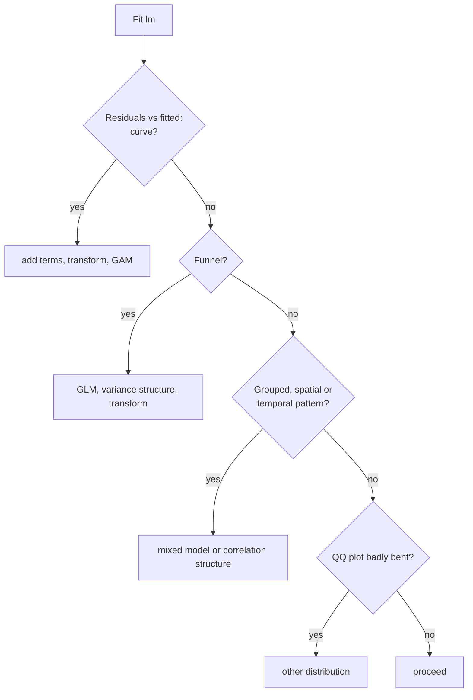

# Linear Model Assumptions

A warranty guarantees a machine will work if you run it on the right voltage, keep it dry and do not overload it. Ignore the conditions and it may still run, but the guarantee is void. The **linear model assumptions** are the conditions under which a [[Linear Model|linear model]]'s estimates, standard errors and tests can be trusted ([[Linear Regression]]). Most concern the [[Error Term]]. In order of importance, after Gelman and Hill: *validity*, that the data and model address the question at all; [[Linearity]] and additivity, that the mean of y is the [[Linear Function|straight-line function]] of the [[Predictor Variable|predictors]] the formula specifies; [[Independence of Observations|independence]], that one observation's [[Deviation|deviation]] says nothing about another's; equal variance, that the scatter around the line is the same size everywhere ([[Homogeneity of Variance]]); and [[Normality]] of the errors. A last condition is that predictors are measured without error ([[Fixed X Assumption]]).

The violations do different damage. A wrong shape biases the estimates themselves. Dependence and [[Heteroscedasticity|unequal variance]] leave the estimates roughly right but corrupt the standard errors, so p-values and intervals become overconfident. Non-normality matters least, mainly affecting predictions of individual values. Each is checked with plots of the [[Residual|residuals]] rather than formal tests ([[plot() Diagnostics for lm]]), and the flowchart runs through them one question at a time: a curve in the residuals calls for added terms, a [[Transformation|transformation]] or a GAM; a funnel for a GLM or a variance structure; grouped, spatial or temporal pattern for a [[Mixed Effects Model|mixed model]] or [[Correlation Structure|correlation structure]]; and a badly bent [[QQ Plot|QQ plot]] for another distribution.

Zuur's Chapter 2 is organised around these violations, and each later unit of the course fixes one of them ([[Zuur et al. 2009 Ch2]]). Two confusions. It is not the response that must be normal but the errors, and that is the least important item. And assumptions are not pass or fail: they hold to a degree, and the useful question is whether a violation is big enough to change your conclusions.

*What to look at:* one question per assumption, each with its usual remedy.

## Connections
- **Builds on:** [[Linear Regression]], [[Error Term]], [[Linear Model]], [[Linear Function]], [[Predictor Variable]], [[Deviation]], [[Heteroscedasticity]], [[Transformation]], [[QQ Plot]]
- **Leads to:** [[Linearity]], [[Independence of Observations]], [[Homogeneity of Variance]], [[Normality]], [[Fixed X Assumption]], [[plot() Diagnostics for lm]], [[Mixed Effects Model]], [[Correlation Structure]]
- **Part of:** [[MOC 06 - Linear Models and GLMs|MOC - Linear Models and GLMs]], molecular note [[Which assumption violation leads to which model]]

## Flashcards

What are the main assumptions of a linear model?
??
Validity, linearity/additivity, independent errors, equal error variance, normal errors (and predictors measured without error).
++++

Which linear model assumption is least important for estimating coefficients?
??
Normality of errors.
++++

Which violations mainly corrupt standard errors?
??
Non-independence and unequal variance.
++++
