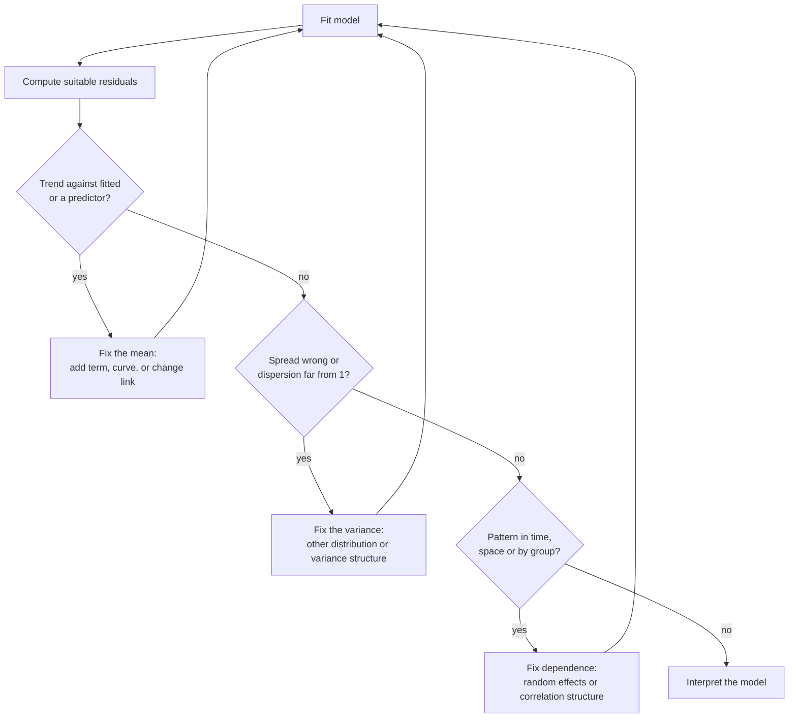

# Model Validation

Before take-off, a pilot walks around the plane looking at the tyres and the flaps, though it has been built, fuelled and given a flight plan; it takes five minutes, and skipping it is how avoidable accidents happen. **Model validation** is that walk-around for a fitted model: the step after fitting in which you check, mostly with residual plots, whether the model's assumptions hold well enough for its conclusions to be trusted ([[Linear Model Assumptions|Assumptions of Linear Regression]], [[Residual]]). It matters because a fitted model always returns numbers, whether or not it is appropriate, and software will not warn you.

The checks are: residuals against fitted values, where a trend means the mean structure is wrong; residuals against each predictor, including ones left out, where a pattern means a missing term; the spread of the residuals, where a fan in scaled residuals means a wrong variance function, with a dispersion check for counts; independence, by plotting residuals against time, in space and by group, where patterns mean [[Autocorrelation]] or a missing grouping factor; the distribution, with a Q-Q plot of suitable residuals and a check of zeros for counts; and influence, whether any single observation drives the result. Use scaled residuals for GLMs, Pearson or quantile, and simulated residuals for mixed models ([[DHARMa Simulated Residuals]]); for `lm` the standard plots are in [[plot() Diagnostics for lm|Diagnostic Plots for lm]]. In the code below, a straight-line Poisson model fitted to humped data leaves Pearson residuals whose means swing negative, positive and negative across the range of x; adding a squared term brings them near zero.

The flowchart shows the loop: a trend sends you to fix the mean, a wrong spread or dispersion far from 1 to fix the variance ([[Overdispersion]]), and a pattern in time, space or groups to fix dependence, each time refitting and checking again. Act on what you find and report what you checked; a Bayesian model is checked the same way with a [[Posterior Predictive Check]] ([[Zuur et al. 2009 Ch2]], [[Zuur et al. 2010]], [[Harrison et al. 2018]], [[Course Website]]). Two confusions. Checking assumptions does not mean testing the raw response for normality; check the residuals of the fitted model. And validation is not model selection: a model can win on AIC and still fail its checks, since AIC ranks models relative to each other and all of them may be poor.


*What to look at:* the loop. Every fix sends you back to refit and check again.

```r
set.seed(11); d <- data.frame(x = runif(200, 0, 3)); d$y <- rpois(200, exp(0.2 + 1.5 * d$x - 0.4 * d$x^2))
m1 <- glm(y ~ x, family = poisson, d); m2 <- glm(y ~ x + I(x^2), family = poisson, d)
chk <- function(m) round(tapply(resid(m, "pearson"), cut(d$x, 0:3), mean), 2)
rbind(straight = chk(m1), curved = chk(m2))             # straight-line model: residual means swing negative, positive, negative. Curved: near zero
```

## Connections
- **Builds on:** [[Residual]], [[Linear Model Assumptions|Assumptions of Linear Regression]]
- **Leads to:** [[DHARMa Simulated Residuals]], [[Overdispersion]], [[Autocorrelation]], [[Posterior Predictive Check]]
- **Part of:** [[MOC 08 - Generalized Linear Models|MOC - Generalized Linear Models]], molecular note [[Which assumption violation leads to which model]]

## Flashcards

What is model validation?
??
Checking a fitted model's assumptions (mean structure, variance, independence, distribution) with residual diagnostics before trusting it.
++++

What does a trend in residuals against a predictor indicate?
??
The mean structure is wrong: a missing term, a nonlinear effect or an unsuitable link.
++++
