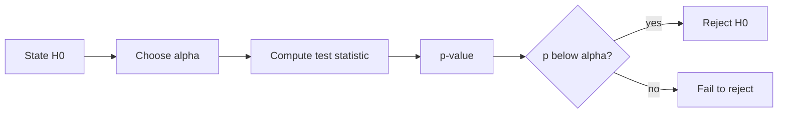

# Null Hypothesis Significance Testing

A courtroom trial run by fixed rules presumes innocence, hears the evidence, and convicts only if the evidence would be very unlikely for an innocent person; the verdict is binary and the standard of proof was set beforehand. **Null hypothesis significance testing** (NHST) is that procedure for data. State H₀, and implicitly its alternative ([[Null Hypothesis]]); choose α ([[Significance Level]]); collect data and compute a [[Test Statistic|test statistic]]; compute the [[P-value]]; and reject H₀ if p < α, otherwise fail to reject. The flowchart shows how the whole procedure ends in a yes or no about one hypothesis.

What it controls is the long-run rate of false positives ([[Type I Error]]). What it does not give is the probability a hypothesis is true, the [[Effect Size|size of an effect]], or a comparison among several explanations. The course readings press four criticisms: nulls are often trivially false; binary decisions hide uncertainty; many unplanned tests produce false findings; and it handles only one alternative at a time ([[Anderson and Burnham 2002]], [[Johnson and Omland 2004]]).

So the course goes on to estimation with intervals, to information-theoretic comparison of several models ([[Multiple Working Hypotheses]], [[Multi-model Inference]], [[Strong Inference]]), and to Bayesian posterior probabilities ([[Frequentist vs Bayesian Inference]]). That does not make NHST wrong: it answers a narrow question correctly. Trouble comes from treating that answer as the scientific conclusion ([[Course Website]]).

*What to look at:* the whole procedure ends in a yes or no about one hypothesis.

## Connections
- **Builds on:** [[Null Hypothesis]], [[P-value]], [[Significance Level]], [[Test Statistic]], [[Effect Size]]
- **Leads to:** [[Multiple Working Hypotheses]], [[Multi-model Inference]], [[Frequentist vs Bayesian Inference]], [[Strong Inference]]
- **Part of:** [[MOC 07 - Likelihood and Estimation|MOC - Likelihood and Estimation]], molecular note [[Null Hypothesis Testing vs Model Selection]]

## Flashcards

What are the steps of null hypothesis significance testing?
??
State H₀, choose α, compute a test statistic, find the p-value, reject H₀ if p < α.
++++

What does NHST control?
??
The long-run rate of false positives (Type I errors).
++++
