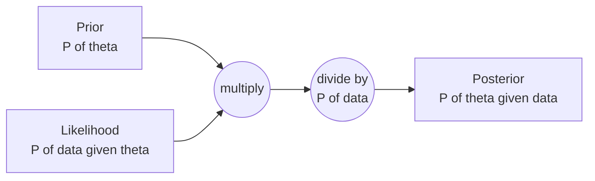

# Bayes' Theorem

You know how often sick people test positive. What you want is the reverse: given a positive test, how likely is it that this person is sick? **Bayes' theorem** is the rule for that reversal, turning the probability of data given a hypothesis into the probability of the hypothesis given the data. A fungus infects 2% of frogs; a swab detects it in 90% of infected frogs and gives a false positive in 5% of healthy ones. A frog tests positive. P(positive and infected) = 0.02 × 0.90 = 0.018, P(positive and healthy) = 0.98 × 0.05 = 0.049, so P(infected | positive) = 0.018 / (0.018 + 0.049) = 0.27. Only 27%, because healthy frogs are so much more numerous.

It follows directly from [[Conditional Probability]]. A [[Joint Probability]] can be written two ways, P(A and B) = P(A | B) P(B) = P(B | A) P(A); set them equal and divide by P(B) to get P(A | B) = P(B | A) P(A) / P(B). For models, put parameters θ for A and data y for B: P(θ | y) = P(y | θ) P(θ) / P(y). The left side is the [[Posterior Distribution]]; on the right are the [[Likelihood]], the [[Prior Distribution]] and the [[Marginal Likelihood]], a constant found with the [[Law of Total Probability]] that makes the posterior sum to 1. Because it doesn't depend on θ, in practice posterior ∝ likelihood × prior, as the flowchart shows. The code below redoes the frog example, then shows that with 30% prevalence the same positive test means an 89% chance of infection.

Models tell us how data arise from parameters, and science needs the opposite direction; Bayes' theorem is the consistent way to reverse it, and it shows the reversal needs a prior ([[Bayesian Inference]], [[Hobbs and Hooten 2015 Ch5]], [[Hobbs and Hooten 2015 Ch3]]). Two confusions. P(A | B) and P(B | A) can differ enormously, here 0.90 against 0.27; confusing them is the prosecutor's fallacy. And the theorem itself is accepted by everyone; the Bayesian step is applying it to parameters.


*What to look at:* two inputs multiplied, then rescaled so the result is a proper distribution.

```r
prior <- c(infected = 0.02, healthy = 0.98); lik <- c(infected = 0.90, healthy = 0.05)
post <- prior * lik / sum(prior * lik); round(post, 3)
prior2 <- c(infected = 0.30, healthy = 0.70); round(prior2 * lik / sum(prior2 * lik), 3)      # a commoner disease: the same test result means much more
```

## Connections
- **Builds on:** [[Conditional Probability]], [[Law of Total Probability]]
- **Leads to:** [[Bayesian Inference]], [[Prior Distribution]], [[Posterior Distribution]], [[Marginal Likelihood]]
- **Part of:** [[MOC 09 - Bayesian Inference|MOC - Bayesian Inference]], molecular note [[Why the posterior is proportional to likelihood times prior]]

## Flashcards

State Bayes' theorem for parameters θ and data y.
??
P(θ | y) = P(y | θ) P(θ) / P(y).
++++

In Bayes' theorem, what are P(θ), P(y | θ) and P(θ | y) called?
??
Prior, likelihood and posterior.
++++

What is the proportional form of Bayes' theorem?
??
Posterior ∝ likelihood × prior.
++++
