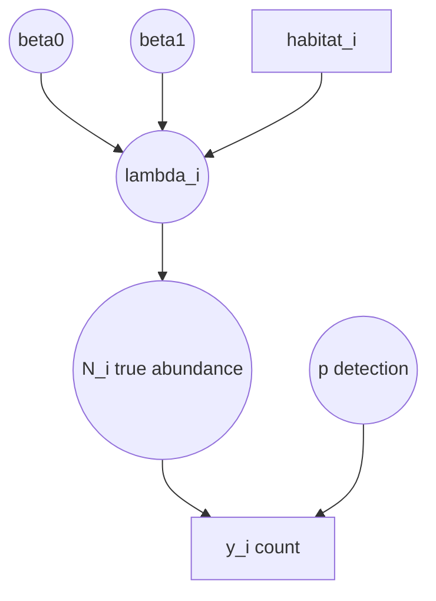

# Directed Acyclic Graph

A family tree for the quantities in a model: arrows run from parents to children, a child's value depends on its parents, and nobody is their own ancestor. A **directed acyclic graph** (DAG) is such a diagram. Each quantity, whether data, [[Latent Variable|latent state]] or parameter, is a node, and an arrow means "depends on": the node at the head is conditional on the node at the tail ([[Conditional Probability]]). Directed means arrows have one direction; acyclic means you can't follow them round in a circle. In Hobbs and Hooten's convention, observed quantities are drawn differently from unobserved ones and the data sit at the bottom.

The graph gives the [[Joint Probability|joint distribution]]: write one bracket per node, [node | its parents], and give priors to nodes without parents. So you draw the diagram, then read the model off it, which also checks completeness, since every unobserved node with no parents needs a prior ([[Parameter Model]]). In the flowchart, circles are unobserved and boxes observed; reading up from the data gives [y | N, p] [N | λ], with λ set by β₀, β₁ and habitat, then priors [β₀] [β₁] [p] ([[Data Model]]). The code below simulates by walking the graph from the top down, giving true abundances N such as 3, 2, 4 and 9 and smaller observed counts y. A node's own terms in the graph define its [[Full-conditional Distribution]].

[[Hobbs and Hooten 2015 Ch6]] uses these diagrams to write every [[Hierarchical Model]]. Arrows show the direction of dependence, how data are generated; inference runs against the arrows. The same kind of picture is also used as a causal diagram, where arrows mean cause: same picture, different purpose.


*What to look at:* circles are unobserved, boxes are observed. Reading upward from the data: [y | N, p] [N | λ] with λ set by β₀, β₁ and habitat, then priors [β₀] [β₁] [p].

```r
set.seed(9); b0 <- 1; b1 <- 1.5; p <- 0.5; habitat <- runif(6)       # simulate by walking the graph from the top down
lambda <- exp(b0 + b1 * habitat); N <- rpois(6, lambda); y <- rbinom(6, N, p); rbind(N, y)
```

## Connections
- **Builds on:** [[Conditional Probability]], [[Joint Probability]], [[Latent Variable]]
- **Leads to:** [[Hierarchical Model]], [[Full-conditional Distribution]], [[Data Model]], [[Parameter Model]]
- **Part of:** [[MOC 09 - Bayesian Inference|MOC - Bayesian Inference]]

## Flashcards

What is a DAG in Bayesian modeling?
??
A diagram with nodes for quantities and arrows for conditional dependence, with no cycles. It specifies how the joint distribution factors.
++++

How do you read a joint distribution from a DAG?
??
One conditional term per node given its parents. Parentless unobserved nodes get priors.
++++
