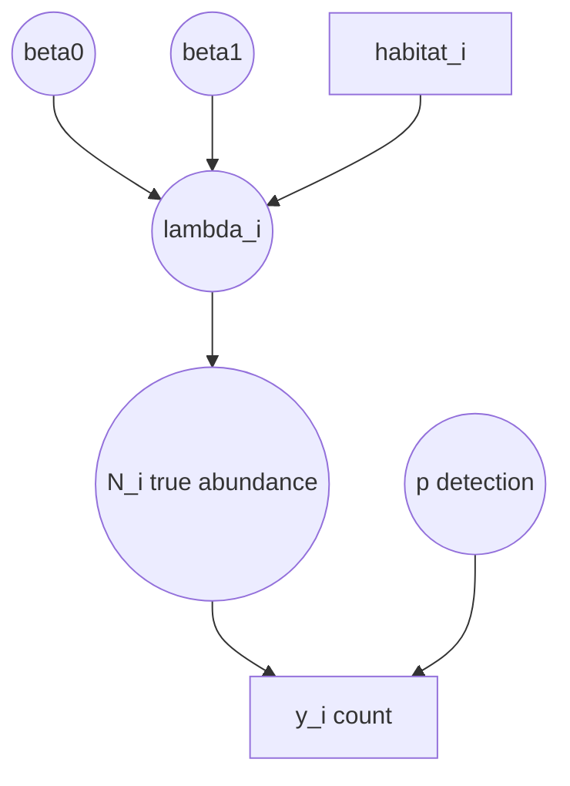

# Directed Acyclic Graph

**In one line:** a directed acyclic graph is a diagram of a model in which each quantity is a node and arrows show which quantities each one depends on, with no loops.

> [!info] Before this, it helps to know
> [[Conditional Probability]] (what an arrow means) · [[Joint Probability]] (what the graph factorises) · [[Hierarchical Model]] (what it usually depicts)

## The everyday picture
A family tree for the quantities in a model. Arrows run from parents to children. A child's value depends on its parents. Nobody is their own ancestor.

## Start from zero
1. **Nodes:** data, latent states, parameters.
2. **Arrows:** "depends on". The node at the head is conditional on the node at the tail.
3. **Directed:** arrows have one direction. **Acyclic:** you can't follow arrows round in a circle.
4. **Convention in Hobbs and Hooten:** observed quantities are drawn differently from unobserved ones, and data sit at the bottom.
5. **The graph gives the joint distribution.** Write one bracket per node: [node | its parents]. Nodes without parents get priors.
6. **So:** draw the diagram, then read the model and its priors off it.
7. **It is a check for completeness.** Every unobserved node with no parents needs a prior.
8. **A different use of DAGs:** causal diagrams, where arrows mean cause. Same picture, different purpose.

## See it

*What to look at:* circles are unobserved, boxes are observed. Reading upward from the data: [y | N, p] [N | λ] with λ set by β₀, β₁ and habitat, then priors [β₀] [β₁] [p].

## In R
```r
set.seed(9); b0 <- 1; b1 <- 1.5; p <- 0.5; habitat <- runif(6)       # simulate by walking the graph from the top down
lambda <- exp(b0 + b1 * habitat); N <- rpois(6, lambda); y <- rbinom(6, N, p); rbind(N, y)
```

## In the course
[[Hobbs and Hooten 2015 Ch6]] uses Bayesian network diagrams to write every model.

## Common confusions
- **"Arrows show the direction of inference."** They show the direction of dependence (data generation). Inference runs against the arrows.

## Explain it back
- Write the joint distribution for the diagram above.

*Pass test:* you can convert between a DAG and a factored joint distribution.

## Connections
- **Builds on:** [[Conditional Probability]], [[Joint Probability]]
- **Leads to:** [[Hierarchical Model]], [[Full-conditional Distribution]], [[Data Model]], [[Parameter Model]]
- **Part of:** [[MOC 09 - Bayesian Inference|MOC - Bayesian Inference]]

## Flashcards

What is a DAG in Bayesian modeling?
??
A diagram with nodes for quantities and arrows for conditional dependence, with no cycles. It specifies how the joint distribution factors.
++++

How do you read a joint distribution from a DAG?
??
One conditional term per node given its parents. Parentless unobserved nodes get priors.
++++
