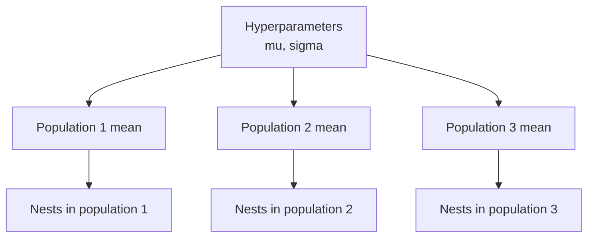

# Hierarchical Model

**In one line:** a hierarchical model is built in layers, where the parameters of one layer are themselves given a distribution governed by parameters in the layer above.

> [!info] Before this, it helps to know
> [[Conditional Probability]] (each layer is conditional on the next) · [[Joint Probability]] (the whole model) · [[Prior Distribution]] (a prior with its own unknowns)

## The everyday picture
A company. Each employee's performance varies around their team's standard. Each team's standard varies around the department's. Each department's varies around the company's. To understand one employee you need all the levels above them, and data on any employee tells you a little about every level.

## A tiny example
Clutch size in 12 populations.
- Level 1 (data): each nest's clutch size ~ Poisson(λ for its population).
- Level 2 (process): each population's log(λ) ~ Normal(μ, σ).
- Level 3 (parameters): priors on μ and σ.
The populations have their own means, but those means are assumed to come from one shared distribution.

## Start from zero
1. **A simple model has one layer:** data depend on parameters, parameters have fixed priors.
2. **A hierarchical model adds layers:** some parameters depend on other parameters (hyperparameters), which have priors of their own.
3. **The joint distribution factors into a chain of conditionals:** [data | process, θ_data] × [process | θ_process] × [parameters].
4. **Why layers:** real data have structure. Nests within populations. Repeated counts of one true abundance. Years within sites.
5. **Use 1, grouping:** group means are drawn from a common distribution. This is a random effect.
6. **Use 2, separating observation from process:** the true state is a hidden layer, and the data are imperfect observations of it.
7. **Consequence, partial pooling:** each group's estimate is pulled toward the overall mean, most strongly for groups with little data.
8. **Fitting:** MCMC handles all layers at once.
9. **Mixed models are hierarchical models** fitted either way. Occupancy models and state-space models are hierarchical models too.

## See it

*What to look at:* information flows up from every group to the hyperparameters and back down to every other group.

## Why it is this way
Ecological data are almost never one flat pile of independent observations. Ignoring the layers either pretends groups are identical or pretends they have nothing in common. A hierarchical model takes the middle course and lets the data decide how alike the groups are.

## In R
```r
set.seed(1); J <- 12; mu <- log(5); sigma <- 0.3; lam <- exp(rnorm(J, mu, sigma)); n_j <- sample(2:15, J, TRUE)
d <- data.frame(pop = factor(rep(1:J, n_j))); d$clutch <- rpois(nrow(d), lam[d$pop])
library(lme4); m <- glmer(clutch ~ 1 + (1 | pop), family = poisson, data = d)
c(mu = unname(fixef(m)), sigma = attr(VarCorr(m)$pop, "stddev"))                  # estimates of the top-layer parameters (true 1.61 and 0.3)
```

## In the course
[[Hobbs and Hooten 2015 Ch6]] is devoted to them. [[Harrison et al. 2018]] and the mixed-model lectures ([[Course Website]]).

## Common confusions
- **"Hierarchical means nested data."** Nesting is one use. The term covers any model whose parameters have distributions with unknown parameters.
- **"Hierarchical models are only Bayesian."** `lmer` fits them by maximum likelihood. Bayes makes complex ones easier.

## Explain it back
- Write the three layers for counts of a species at sites visited several times.

*Pass test:* you can write a model as data, process and parameter layers.

## Connections
- **Builds on:** [[Conditional Probability]], [[Joint Probability]], [[Prior Distribution]]
- **Leads to:** [[Data Model]], [[Process Model]], [[Parameter Model]], [[Hyperparameter]], [[Partial Pooling]], [[Mixed Effects Model|Mixed Model]], [[Directed Acyclic Graph]]
- **Part of:** [[MOC 09 - Bayesian Inference|MOC - Bayesian Inference]], molecular note [[Data Model, Process Model and Parameter Model]]

## Flashcards

What is a hierarchical model?
??
A model with layers, in which parameters at one level have a distribution governed by parameters at a higher level.
++++

How does the joint distribution of a hierarchical model factor?
??
[data | process, parameters] × [process | parameters] × [parameters].
++++

What estimation behaviour do hierarchical models produce for groups?
??
Partial pooling: group estimates shrink toward the overall mean.
++++
