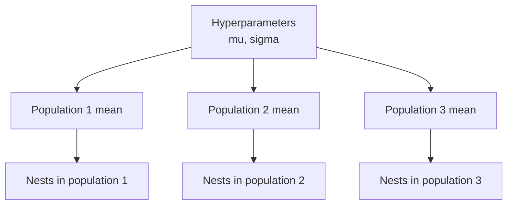

# Hierarchical Model

In a company, each employee's performance varies around their team's standard, each team's standard varies around the department's, and each department's around the company's. To understand one employee you need all the levels above, and data on any employee tell you a little about every level. A **hierarchical model** is built in such layers: the parameters of one layer are themselves given a distribution governed by parameters in the layer above ([[Prior Distribution]], [[Hyperparameter]]). Take clutch size in 12 bird populations. Level 1, the data: each nest's clutch size ~ Poisson(λ for its population). Level 2, the process: each population's log(λ) ~ Normal(μ, σ). Level 3, the parameters: priors on μ and σ. Each population has its own mean, but the means come from one shared distribution.

A simple model has one layer: data depend on parameters, and parameters have fixed priors. A hierarchical model adds layers, and its joint distribution factors into a chain of conditionals, [data | process, θ_data] × [process | θ_process] × [parameters], each layer conditional on the one above ([[Conditional Probability]], [[Joint Probability]], [[Data Model]], [[Process Model]], [[Parameter Model]]). Layers are needed because real data have structure: nests within populations, repeated counts of one true abundance, years within sites. They serve two purposes: grouping, where group means are drawn from a common distribution, which is a random effect ([[Group-level Model]]); and separating observation from process, where the true state is a hidden layer seen through imperfect data. The consequence is [[Partial Pooling]]: each group's estimate is pulled toward the overall mean, most strongly for groups with little data. The flowchart shows how information flows up from each group to the hyperparameters and back down to every other group. In the code below, `glmer` recovers the top-layer parameters of simulated clutch data, μ = 1.71 and σ = 0.20 against true values of 1.61 and 0.3.

Ignoring the layers either pretends groups are identical or pretends they have nothing in common; a hierarchical model takes the middle course and lets the data decide how alike the groups are. [[Hobbs and Hooten 2015 Ch6]] is devoted to them, and they appear in [[Harrison et al. 2018]] and the mixed-model lectures ([[Course Website]]). Two confusions. "Hierarchical" does not just mean nested data; it covers any model whose parameters have distributions with unknown parameters, including occupancy and state-space models. And hierarchical models are not only Bayesian: `lmer` fits them by maximum likelihood, and a [[Mixed Effects Model|Mixed Model]] is one; Bayesian fitting with MCMC makes complex ones easier. A [[Directed Acyclic Graph]] is the usual way to draw one.


*What to look at:* information flows up from every group to the hyperparameters and back down to every other group.

```r
set.seed(1); J <- 12; mu <- log(5); sigma <- 0.3; lam <- exp(rnorm(J, mu, sigma)); n_j <- sample(2:15, J, TRUE)
d <- data.frame(pop = factor(rep(1:J, n_j))); d$clutch <- rpois(nrow(d), lam[d$pop])
library(lme4); m <- glmer(clutch ~ 1 + (1 | pop), family = poisson, data = d)
c(mu = unname(fixef(m)), sigma = attr(VarCorr(m)$pop, "stddev"))                  # estimates of the top-layer parameters (true 1.61 and 0.3)
```

## Connections
- **Builds on:** [[Conditional Probability]], [[Joint Probability]], [[Prior Distribution]]
- **Leads to:** [[Data Model]], [[Process Model]], [[Parameter Model]], [[Hyperparameter]], [[Partial Pooling]], [[Mixed Effects Model|Mixed Model]], [[Directed Acyclic Graph]]
- **Part of:** [[MOC 09 - Bayesian Inference|MOC - Bayesian Inference]], molecular note [[Data Model, Process Model and Parameter Model]]

## Flashcards

What is a hierarchical model?
??
A model with layers, in which parameters at one level have a distribution governed by parameters at a higher level.
++++

How does the joint distribution of a hierarchical model factor?
??
[data | process, parameters] × [process | parameters] × [parameters].
++++

What estimation behaviour do hierarchical models produce for groups?
??
Partial pooling: group estimates shrink toward the overall mean.
++++
