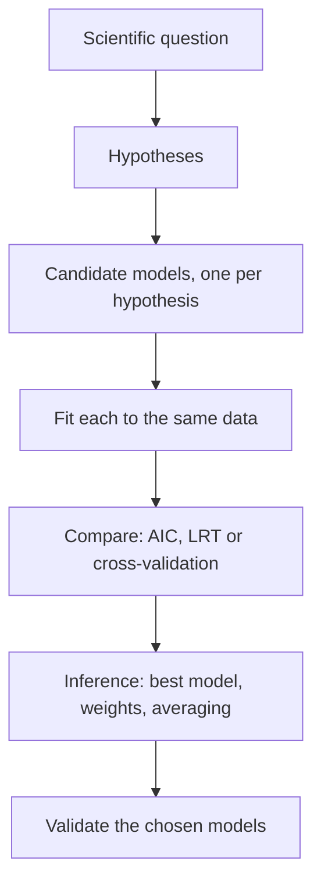

# Model Selection

A hand-drawn sketch of a hiking route misses the cliffs, and a satellite photo shows every leaf and hides the path; the useful map is the one that best guides you through ground you haven't walked yet. **Model selection** is choosing among several candidate models of the same data, differing in predictors, interactions, distributions or random effects, to decide which are best supported or how to combine them ([[Statistical Model]]). Raw fit can't be the criterion, because adding parameters always improves fit to the data in hand ([[Likelihood]], [[Overfitting]], [[Underfitting]]). What we want is the model that would best describe new data from the same process.

There are three broad tools: tests between nested models such as the [[Likelihood Ratio Test]], information criteria such as [[AIC]], BIC and WAIC, and [[Cross-validation]]. They serve two purposes with different best tools, explaining which hypotheses are supported and predicting best. The flowchart shows the sequence: models come from hypotheses, are fitted to the same data, compared, and the chosen ones validated. In the code below, five Poisson models of bird counts are fitted: the log-likelihood rises steadily from the null model (−237) to the model with a pure-noise predictor (−192.6), but AIC is lowest for the model with tree and shrub cover (391.7) and rises again when noise is added (393.2).

The [[Candidate Model Set]] matters more than the criterion: if no good model is in the set, the "best" one is just the least bad. The best model isn't the truth either, only the best approximation among those considered, given these data. Uncertainty about which model is best is real and should be carried into conclusions, by reporting several close models or by [[Multi-model Inference]]. This is the subject of the model selection lectures and lab and of [[Johnson and Omland 2004]], [[Anderson and Burnham 2002]] and [[Hobbs and Hooten 2015 Ch9]] ([[Course Website]]). Picking the top model and forgetting the rest throws away the information in close competitors.


*What to look at:* models come from hypotheses, not from the data.

```r
set.seed(2); d <- data.frame(tree = runif(80, 0, 60), shrub = runif(80, 0, 30), noise = rnorm(80)); d$birds <- rpois(80, exp(2.3 - 0.02 * d$tree + 0.015 * d$shrub))
ms <- list(null = birds ~ 1, tree = birds ~ tree, shrub = birds ~ shrub, both = birds ~ tree + shrub, all = birds ~ tree + shrub + noise)
fits <- lapply(ms, glm, family = poisson, data = d)
round(sapply(fits, function(m) c(logLik = as.numeric(logLik(m)), K = attr(logLik(m), "df"), AIC = AIC(m))), 1)       # fit always improves. AIC doesn't.
```

## Connections
- **Builds on:** [[Statistical Model]], [[Likelihood]], [[Overfitting]]
- **Leads to:** [[AIC]], [[Candidate Model Set]], [[Cross-validation]], [[Likelihood Ratio Test]], [[Multi-model Inference]]
- **Part of:** [[MOC 10 - Model Selection|MOC - Model Selection]], molecular note [[Null Hypothesis Testing vs Model Selection]], [[Why AIC rewards fit but punishes complexity]]

## Flashcards

What is model selection?
??
Comparing candidate models of the same data to identify those best supported, or to combine them.
++++

Why can't model fit alone be used to choose among models?
??
Adding parameters always improves fit to the data in hand, even when they only fit noise.
++++
