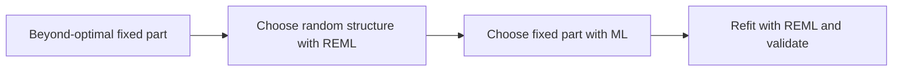

# Top-down Model Selection Protocol

The **top-down protocol** for [[Mixed Effects Model|mixed models]] starts with all candidate [[Fixed Effect|fixed effects]], settles the random structure using [[REML]], then simplifies the fixed effects using ML, and finally refits the chosen model with REML ([[Maximum Likelihood Estimation]], [[Global Model]]). Step 1 fits a "beyond optimal" model with all explanatory variables and plausible interactions in the fixed part. Step 2 keeps that fixed part and finds the best random structure, and variance structure, by comparing REML fits by AIC or LRT, mindful of the [[Boundary Problem When Testing Variances]]. Step 3 keeps that random structure and finds the best fixed part by comparing ML fits. Step 4 refits the final model with REML and validates it with residual checks ([[Model Validation]]).

The order matters: if the fixed part is too small, unexplained fixed structure leaks into the [[Random Effect|random effects]], and a poor random structure biases the fixed-effect standard errors. [[Zuur et al. 2009 Ch5]] present this four-step version and a longer ten-step protocol with [[Linear Regression|linear regression]] and GLS steps first ([[Variance Structures]]). The linear mixed models lab follows it, comparing random structures with [[AICc]] and then fixed effects with ML ([[Course Website]]). Selecting fixed effects first and adding random effects afterward gets it backwards: the random structure needs a rich fixed part to be judged fairly.

## Connections
- **Builds on:** [[REML]], [[Maximum Likelihood Estimation]], [[Global Model]], [[Mixed Effects Model]], [[Fixed Effect]], [[Random Effect]], [[Linear Regression]], [[AICc]]
- **Leads to:** [[REML vs ML]], [[Variance Structures]], [[Model Validation]]
- **Part of:** [[MOC 14 - Mixed Models|MOC - Mixed Models]]

## Flashcards

What are the steps of Zuur's top-down protocol?
??
Beyond-optimal fixed part; choose random structure with REML; choose fixed part with ML; refit with REML and validate.
++++
