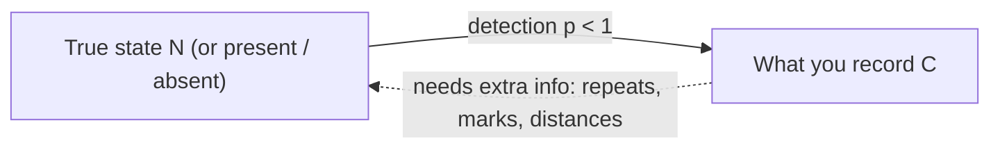

# Imperfect Detection

Looking for your keys in a messy room, not finding them does not prove they are not there; how hard you looked and how good you are at spotting keys decide how much "not found" should convince you. **Imperfect detection** means a survey can miss animals or species that are really there, so what you record is smaller than what exists ([[Count Data]], [[Observation Error]]). Powell and Gale (2015 Ch14) write this as C ≠ N: the count C is almost never the true number N, and C ≤ N when there are no false positives. A zero is ambiguous, meaning either absent or present and missed (a [[Type II Error|false negative]]).

Detection varies: thick habitat, bad weather, shy animals and tired observers all lower it, so raw counts can mislead even as a relative measure. If detection is lower in dense forest than in open grassland, raw counts will say the forest has fewer animals even when it has more, and habitat conclusions then reflect where animals are easy to see, not where they live. The fix is a second source of information about detection: [[Repeat-Visit Design|repeat visits]], marks, two observers, distances or removals, and each method in this folder is one such source ([[Occupancy]], [[Mark-Recapture]], [[Double-observer Methods]], [[Distance Sampling]], [[Removal Sampling]]). The diagram shows the true state N as a [[Latent Variable]]; the dashed arrow back from the count is the hard part, and every estimation method is a way of drawing it.

[[Guélat and Kéry 2018]] simulated abundance data and found that ignoring imperfect detection with a [[Poisson Regression|Poisson GLM]] badly damaged abundance maps, especially combined with [[Spatial Autocorrelation|spatial autocorrelation]] ([[N-mixture Model]]). It is the theme of the population estimation guest lectures ([[Course Website]], [[Powell and Gale 2015]] Ch14 and Ch15). A careful observer still has a detection problem: even perfect observers miss animals that are underground, silent or behind a bush ([[Availability for Detection]], [[Detection Probability]]).

*What to look at:* the dashed arrow is the hard part; every estimation method is a way of drawing it.

## Connections
- **Builds on:** [[Count Data]], [[Latent Variable]], [[Observation Error]], [[Type II Error]], [[Poisson Regression]], [[Spatial Autocorrelation]]
- **Leads to:** [[Detection Probability]], [[Occupancy]], [[N-mixture Model]], [[Mark-Recapture]], [[Distance Sampling]], [[Repeat-Visit Design]]
- **Part of:** [[MOC 16 - Population Estimation|MOC - Population Estimation]], molecular note [[Why raw counts mislead]], [[Naive vs Estimated Occupancy]]

## Flashcards

What is imperfect detection?
??
A survey can miss animals or species that are present, so records undercount reality.
++++

What two things can a survey zero mean?
??
The species or animal is absent, or it is present but was missed.
++++
