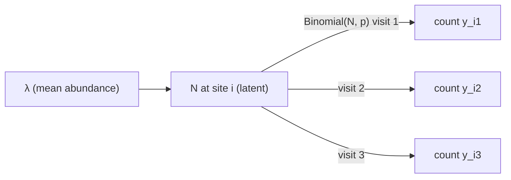

# N-mixture Model

Counting birds at a feeder on three mornings you might see 0, 1 and 1: you never see them all at once, but the spread of counts across many feeders tells you how often birds are missed, and so how many there really are. An **N-mixture model** estimates site abundance from repeated counts of unmarked animals, treating true abundance N as Poisson and each count as a binomial sample of N with detection probability p ([[Poisson Distribution]], [[Binomial Distribution]], [[Latent Variable]]). The model is Nᵢ ~ Poisson(λ) and yᵢⱼ ~ Binomial(Nᵢ, p). It is a "mixture" because the likelihood sums the binomial over all possible N values, weighted by the Poisson. It was introduced by Royle (2004).

Closure is at the individual level for all visits, stricter than occupancy's species-level closure ([[Closure Assumption]]); [[Occupancy]] is the presence/absence cousin, while N-mixture uses the counts themselves. Raw mean or maximum counts underestimate N and are not comparable where detection differs, such as dense against open habitat. In Powell and Gale's (Ch18) five points with true N = 4, 2, 3, 0 and 9, the counts were 0-0-4, 0-1-1, 0-0-0, 0-0-0 and 5-6-2: the maximum never exceeds and usually falls below the true N. The diagram shows one hidden number per site seen through several noisy counts. In the code below 150 sites with a true mean N of 5.0 and p = 0.4 give a mean maximum count of only 2.8, while the model estimates λ̂ = 4.96 and p̂ = 0.40.

It is sensitive to assumptions: unmodelled heterogeneity, double counting or movement can inflate λ̂. [[Guélat and Kéry 2018]] added spatial terms, CAR or 2-D splines, to N-mixture models ([[Spatial Smooths]], [[Powell and Gale 2015]] Ch18, [[unmarked Package]]). The maximum count is not a good abundance estimate; it is biased low whenever p < 1.


*What to look at:* one hidden number per site, seen through several noisy counts.

```r
set.seed(9); S <- 150; K <- 3; Ni <- rpois(S, 5); y <- matrix(rbinom(S * K, rep(Ni, K), 0.4), S, K)
nll <- function(b) { l <- exp(b[1]); pp <- plogis(b[2]); -sum(sapply(1:S, function(i) { Ns <- max(y[i, ]):60
  log(sum(dpois(Ns, l) * sapply(Ns, function(n) prod(dbinom(y[i, ], n, pp))))) })) }
g <- optim(c(1, 0), nll)
round(c(true_mean_N = mean(Ni), mean_max_count = mean(apply(y, 1, max)), lambda_hat = exp(g$par[1]), p_hat = plogis(g$par[2])), 2)
```

## Connections
- **Builds on:** [[Occupancy]], [[Poisson Distribution]], [[Binomial Distribution]], [[Latent Variable]]
- **Leads to:** [[unmarked Package]], [[Closure Assumption]], [[Abundance]]
- **Part of:** [[MOC 16 - Population Estimation|MOC - Population Estimation]], molecular note [[Occupancy vs Abundance]], [[Why raw counts mislead]]

## Flashcards

Write the N-mixture model.
??
N_i ~ Poisson(λ); y_ij ~ Binomial(N_i, p).
++++

Why is it called a mixture model?
??
The likelihood sums over every possible latent N, mixing binomials weighted by the Poisson.
++++
