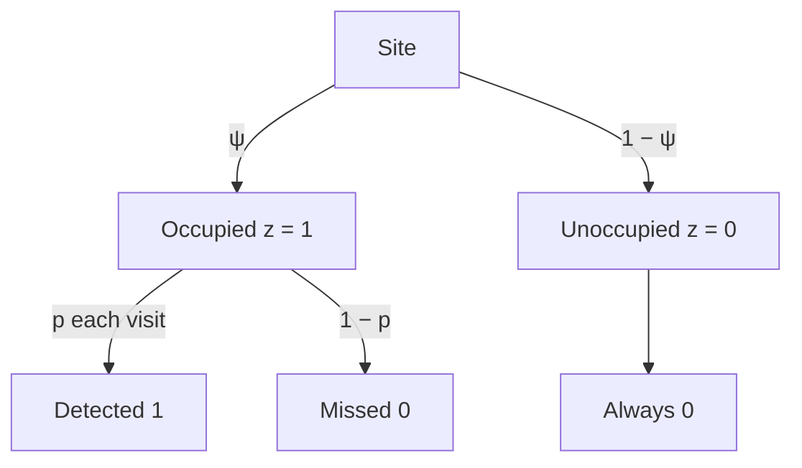

# Occupancy

Checking which houses on a street have a cat is hard when some cats hide whenever you visit; but if you visit each house several times, the pattern of sightings at houses where you did see a cat tells you how often cats hide, and so how many "no cat" houses probably have a hidden one. **Occupancy** ψ (psi) is the probability that a site is occupied by a species, or equivalently the proportion of sites occupied, estimated while accounting for [[Imperfect Detection]] ([[Detection Probability]], [[Bernoulli Distribution]]). There are two parameters: ψ, the site is occupied, and p, the species is detected on a visit given that the site is occupied. The true state z, 1 or 0, is a [[Latent Variable]], and the data are [[Detection History|detection histories]] from [[Repeat-Visit Design|repeat visits]].

Powell and Gale (2015 Ch15) give four points with three visits and histories 000, 000, 010 and 111: [[Naive Occupancy]] is 2 of 4 = 50%, but the true states were 1, 0, 1, 1, so true occupancy was 75%. Whenever p < 1, ψ̂ is at least the naive occupancy. The diagram shows why: zeros come from two branches, unoccupied or occupied and missed, and repeat visits let the model split them. In the code below 100 sites with true occupancy 0.57 and p = 0.3 give a naive occupancy of 0.41, while maximising the occupancy likelihood gives ψ̂ = 0.58 and p̂ = 0.26 ([[Single-season Occupancy]]).

Occupancy data are cheap: presence or absence by sight, sign, calls, cameras or recordings ([[Choosing a Survey Method for Occupancy]]). The Nov 3 [[Occupancy Guest Lecture]] lists what occupancy is designed for: understanding changes or differences in the proportion of occupied sites across space or time, which underlies distribution models, habitat suitability models and metapopulation models, and multi-season models of colonization and extinction ([[Species Distribution Model]], [[Metapopulation]]). They suit rare or elusive species, range monitoring, habitat relationships, invasive spread and disease. The model was introduced by MacKenzie et al. (2002) and Tyre et al. (2003), as cited in Powell and Gale; [[Guélat and Kéry 2018]] treat site-occupancy models as the occurrence analogue of N-mixture models ([[N-mixture Model]], [[Course Website]], [[Powell and Gale 2015]] Ch15). Occupancy is not abundance: a site with one animal and a site with fifty are both occupied. And ψ is not the proportion of sites where the species was seen.


*What to look at:* zeros come from two branches; repeat visits let the model split them.

```r
set.seed(1); S <- 100; K <- 4; z <- rbinom(S, 1, 0.6); y <- matrix(rbinom(S * K, 1, z * 0.3), S, K)
d <- rowSums(y); nll <- function(b) { ps <- plogis(b[1]); pp <- plogis(b[2]); -sum(log(ps * pp^d * (1 - pp)^(K - d) + (1 - ps) * (d == 0))) }
fit <- optim(c(0, 0), nll)
round(c(true = mean(z), naive = mean(d > 0), psi_hat = plogis(fit$par[1]), p_hat = plogis(fit$par[2])), 2)
```

## Connections
- **Builds on:** [[Imperfect Detection]], [[Detection Probability]], [[Latent Variable]]
- **Leads to:** [[Detection History]], [[Occupancy Likelihood]], [[Naive Occupancy]], [[Single-season Occupancy]], [[Multi-season Occupancy]], [[Multi-species Occupancy Model|Multi-species Occupancy]], [[Closure Assumption]], [[Repeat-Visit Design]]
- **Part of:** [[MOC 16 - Population Estimation|MOC - Population Estimation]], molecular note [[Naive vs Estimated Occupancy]], [[Occupancy vs Abundance]], [[Occupancy vs Detection Probability]], [[Assumptions of Occupancy Models]], [[Occupancy Workflow in R]], [[Fisher Occupancy Case Study]]

## Flashcards

What is occupancy ψ?
??
The probability a site is occupied by a species (proportion of sites occupied), accounting for imperfect detection.
++++

In the simulation (true 0.57), why was naive occupancy only 0.41?
??
With p = 0.3 and 4 visits, many occupied sites were never detected.
++++
