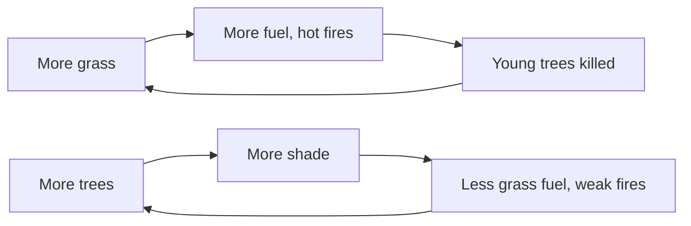

# Feedback Loops in Ecology

Two everyday loops. A thermostat: the room gets too warm, the heater switches off, the room cools, the heater switches back on, so any change is pushed back. A microphone squeal: the mic picks up sound from the speaker, which amplifies it, which the mic picks up again, louder each time, so any change is pushed further. A **feedback loop** is a chain of cause and effect that comes back around to affect its own starting point. *Negative feedback* opposes change and keeps a system steady, like the thermostat; *positive feedback* amplifies change and makes it run away, like the squeal. "Negative" and "positive" do not mean bad and good: they mean "opposes" and "amplifies".

Grasslands run on two such loops at once. The grass-fire loop is negative feedback: lots of grass grows, dead grass is fuel so fires burn hot and spread, fire kills young trees while grass resprouts from its roots, and so grass stays dominant ([[Disturbance]], a sudden event that removes plants; [[Prescribed Fire]]). The tree-shade loop is positive feedback: a few trees survive between fires, they shade the ground so less grass grows beneath them, less grass means less fuel so fires there are weak, and weak fires kill fewer seedlings, so more trees survive, which is [[Ecological Succession]] (the slow push from grass toward forest) speeding itself up. Which loop wins depends on how much tree cover there already is. Take a toy rule where each year fire removes trees in proportion to grass fuel: at 10% tree cover fuel is high, fire removes most new trees, and cover returns to about 10%; at 30% fuel is medium and cover creeps up to 33%; at 50% fuel is low and cover jumps to 60% (invented numbers). At 10% negative feedback wins; at 50% each year makes the next worse. Somewhere between lies a [[Tipping Point|tipping point]], and crossing it flips grassland to woodland, a [[Regime Shift|regime shift]] ([[Ecological Resilience and Alternative States]], [[Regime Shifts and Spatial Early Warning Signals]]).

*What to look at:* the left loop pushes back toward grass (negative feedback); the right loop feeds on itself toward trees (positive feedback).

Three confusions. Negative feedback is not bad: it is the stabiliser, and the grass-fire loop is what keeps a grassland healthy. Positive feedback is not good: it amplifies whatever is happening, including encroachment. And change is not always gradual: feedback can make a system look stable for years and then flip quickly once a tipping point is crossed ([[Woody Encroachment]]). The theory behind [[Berry et al. 2026]], as set out in Berry's 2024 thesis, treats grasslands and woodlands as alternative regimes; an intact [[Grassland Core Habitat|grassland core]] is held in place by negative feedbacks such as fire, and where the two regimes meet there is a boundary that [[Spatial Covariance]] picks up as negative values ([[Why negative spatial covariance marks a tree-grass boundary]]; which values mark a core is still unresolved). This is why [[Defend the Core]] protects intact cores first: a core still has its grass-fire loop working, so it is cheap to keep, while a woody area has already crossed into the tree-shade loop and is expensive to restore ([[Why trees take over grasslands without fire]]).

## Connections
- **Builds on:** [[Disturbance]], [[Prescribed Fire]], [[Ecological Succession]], [[Tipping Point]]
- **Leads to:** [[Ecological Resilience and Alternative States]], [[Woody Encroachment]], [[Grassland Core Habitat]], [[Spatial Covariance]], [[Defend the Core]], [[Regime Shift]]
- **Part of:** [[MOC 19 - Ecology Vocabulary|MOC - Ecology Vocabulary]]
- **Go deeper:** [[Regime Shifts and Spatial Early Warning Signals]], [[Why negative spatial covariance marks a tree-grass boundary]], [[Why trees take over grasslands without fire]], [[Berry et al. 2026]]

## Flashcards

In the grass-fire loop, why is it called *negative* feedback even though it is good for grassland birds?
??
"Negative" means it opposes change. When trees start to appear, fire fuelled by grass removes them and pushes the system back to grassland.
++++

Why does the tree-shade loop count as positive feedback?::More trees mean more shade, less grass fuel and weaker fires, which lets even more trees survive: the change amplifies itself.
