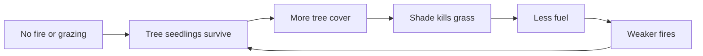

# Woody Encroachment

Leave a lawn unmowed for twenty years and it stops being a lawn: seeds blow in or are dropped by birds, seedlings sprout, and soon there are shrubs, then trees. Prairies work the same way. *Woody plants* are trees and shrubs, plants with hard stems that survive year after year, while grasses die back to the ground each winter. A [[Grassland]] (land covered mainly by grasses, with few or no trees) stays open only because something keeps killing the tree seedlings, historically fire and [[Grazing]] by animals such as bison. **Woody encroachment** is what happens when that stops: trees and shrubs slowly spread into the grassland and turn it into shrubland or woods. It is one stage of [[Ecological Succession]], the natural sequence in which one plant community gives way to the next.

The reason it is hard to undo is that it feeds on itself. Follow a made-up field with no fire. In year 0 it has 5% tree cover and plenty of dry grass, the fuel that lets a fire run through. By year 10 it has 20% tree cover; the trees shade out some grass, so there is less fuel and fires burn weaker. Weaker fires kill fewer seedlings, so by year 20 cover reaches 50% and fires barely carry at all. Each step makes the next more likely, a loop that pushes the field one way (the flowchart below). Past a point, letting fire back in is not enough, because there is too little grass left to burn, and trees have to be cut. That is why ecologists describe encroachment as a possible [[Regime Shifts and Spatial Early Warning Signals|regime shift]], a jump into a new stable state, rather than a gradual change that reverses easily. [[Prescribed Fire]], fire set on purpose by managers, is the main tool for stopping it early. In the Great Plains a common invader is eastern redcedar, often spreading from planted windbreaks.

Why does a few trees matter so much to a bird like the [[Eastern Meadowlark]], which nests on the ground in open grass? A tree is a lookout perch for hawks and crows, and for [[Brood Parasitism|cowbirds]] that lay their eggs in other birds' nests. Woods shelter raccoons and snakes that hunt out into the grass. So even a scattered line of trees creates new [[Edge Effects]] (worse conditions near a habitat boundary) and splits the open habitat into pieces ([[Habitat Fragmentation]]), one driver of [[Grassland Bird Decline]]. The common confusion is that more trees means more wildlife: that holds for forest birds, but for [[Habitat Specialist|grassland specialists]] tree cover removes [[Habitat]] (a few species, such as the [[Northern Bobwhite]], do use some shrub cover; see [[Grassland Specialists vs Generalists]]). In the grassland bird project, measured as [[Canopy Cover|tree cover]] within 50 m of each survey point, focal grassland [[Species Richness]] was about 45% lower for each [[Standard Deviation|standard deviation]] more tree cover ([[Rate Ratio|rate ratio]] 0.55, 95% CI 0.48 to 0.63), the strongest habitat effect found, while all-species richness showed no tree effect ([[Preliminary Results]]). Powell and Gale use greater prairie-chickens shifting habitat between seasons as an example of a [[Closure Assumption]] problem in occupancy studies ([[Powell and Gale 2015]], Ch15).

*What to look at:* the arrow from "Weaker fires" back to "Tree seedlings survive" closes the loop; every pass round it makes the next pass easier.

## Connections
- **Builds on:** [[Grassland]], [[Grazing]], [[Ecological Succession]], [[Habitat Specialist]], [[Standard Deviation]], [[Rate Ratio]], [[Brood Parasitism]]
- **Leads to:** [[Regime Shifts and Spatial Early Warning Signals]], [[Prescribed Fire]], [[Edge Effects]], [[Habitat Fragmentation]], [[Grassland Bird Decline]], [[Canopy Cover]], [[Species Richness]]
- **Part of:** [[MOC 19 - Ecology Vocabulary|MOC - Ecology Vocabulary]], [[MOC 24 - Grassland Bird Ecology|MOC - Grassland Bird Ecology]]
- **Go deeper:** [[Why trees take over grasslands without fire]], [[Grassland Specialists vs Generalists]], [[Eastern Meadowlark]], [[Northern Bobwhite]], [[Habitat]], [[Habitat Structure]], [[Fire History Variables]], [[Closure Assumption]], [[Preliminary Results]], [[Hypotheses]], [[Berry et al. 2026]], [[Brennan and Kuvlesky 2005]], [[Powell and Gale 2015]]

## Flashcards

What is woody encroachment?::Trees and shrubs spreading into grassland, turning it into shrubland or woods.

Why is woody encroachment often self-reinforcing?
??
Trees shade out grass, which removes the fuel that carries fire. Weaker fires kill fewer seedlings, so more trees grow and there is even less fuel.
++++

Why can a few trees harm ground-nesting grassland birds?
??
Trees give predators and cowbirds lookout perches, shelter nest predators, and break open habitat into edges and fragments.
++++
