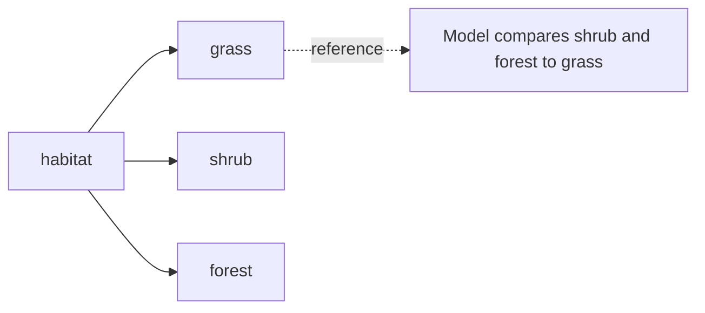

# Categorical Variable

**In one line:** a categorical variable records which group something belongs to, using names rather than amounts, such as habitat type or observer. R calls it a **factor**, and each name is a **level**.

> [!info] Before this, it helps to know
> [[Variable]] · [[Discrete Data]] (another non-continuous kind)

## The everyday picture
Sorting laundry into piles: whites, colours, darks. The piles have names, not sizes. "Darks" isn't twice "whites". You can count how many items are in each pile, but you can't add or average the pile names.

Habitat type is the same: grassland, shrubland, forest are piles, not points on a scale.

*Where the picture stops working:* some categories do have an order (small, medium, large). Those are *ordinal*, a special case.

## Words you'll need
- **Categorical variable:** a variable whose values are group names.
- **Factor:** R's name for a categorical variable.
- **Level:** one of the possible groups (grassland is a level of habitat).
- **Reference level:** the level a model compares the others against ([[Dummy Coding]]).
- **Ordinal:** categories with a natural order but no fixed spacing.

## A tiny example
Habitat at five plots: grass, forest, grass, shrub, grass.
- Counting is fine: grass 3, forest 1, shrub 1.
- Suppose someone codes them 1 = grass, 2 = shrub, 3 = forest and averages: (1 + 3 + 1 + 2 + 1) / 5 = **1.6**. "Habitat 1.6" means nothing. Recode forest as 2 and shrub as 3 and the "average" changes, even though no plot changed. That's the sign a variable is categorical.

## Start from zero
1. **Some variables are names, not amounts.** Habitat, observer, treatment.
2. **You can count members of each group, but not do arithmetic on the names.** *Why:* the names have no size or spacing.
3. **Numbers used as labels are still labels.** Plot IDs or habitat codes 1, 2, 3 are categorical.
4. **Tell R it's a factor.** *Why:* otherwise R fits a slope across the codes, as if forest were "three times" grassland.
5. **In a model, a factor becomes a set of comparisons.** Each level gets its own difference from the reference level ([[Dummy Coding]]).

## See it

*What to look at:* levels are separate boxes, not points on a line.

## Why it is this way
Arithmetic only makes sense on amounts. Marking a variable as categorical protects you from silent nonsense, and tells the model to estimate a separate effect for each group.

## In R
```r
habitat <- factor(c("grass", "forest", "grass", "shrub", "grass"))
levels(habitat)     # "forest" "grass" "shrub" (alphabetical by default)
table(habitat)      # counts per level: fine
codes <- c(1, 3, 1, 2, 1)
mean(codes)         # 1.6: arithmetic on labels is meaningless
```

## In the course
Categorical predictors appear in every lab, and grouping factors such as site are the heart of mixed models ([[Grouping Factor]]).

## Common confusions
- **"Coding habitat as 1, 2, 3 makes it a number."** It's still a label.
- **"Categorical means discrete counts."** Counts have size and order; categories don't.

## Explain it back
- Use laundry piles to explain a categorical variable.
- Why does the "average habitat" of 1.6 mean nothing?
- What goes wrong if R treats habitat codes as numbers?

*Pass test:* you can spot a number column that is really a label.

## Connections
- **Builds on:** [[Variable]]
- **Leads to:** [[Dummy Coding]], [[Grouping Factor]], [[Interaction]]
- **Part of:** [[MOC - Basics from Zero]], molecular note [[Continuous vs Discrete Data]]
- **Go deeper:** [[Data Frames and Tibbles]]

## Flashcards

You code habitat as 1, 2, 3. What must you tell R and why?
??
That it is a factor (categorical); otherwise R fits a meaningless slope across the codes.
++++

What is a factor level?
??
One of the named groups a categorical variable can take (e.g., grassland is a level of habitat).
++++
